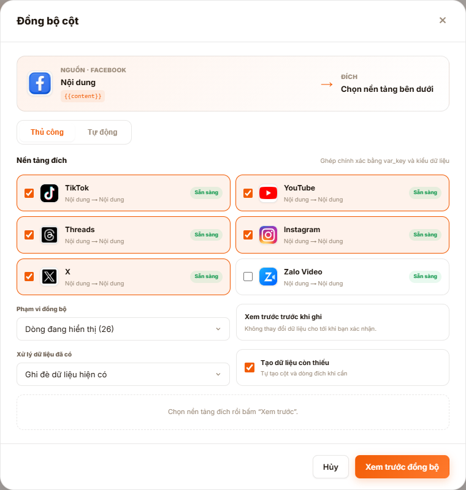
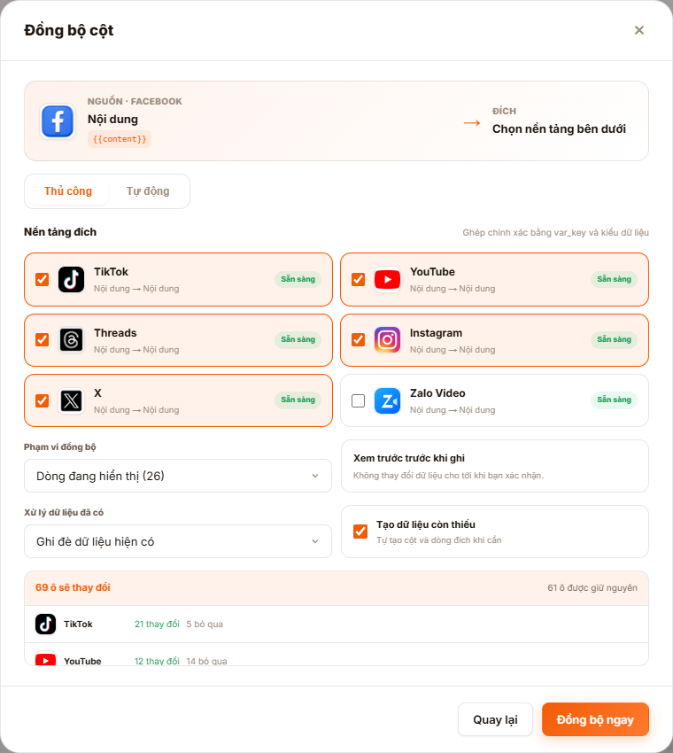
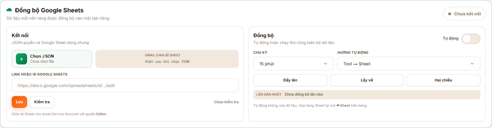

# HƯỚNG DẪN ĐỒNG BỘ DỮ LIỆU

Cập nhật: 17/08/2026

Tool có hai cách đồng bộ:

1. Đồng bộ một cột sang các nền tảng khác.
2. Đồng bộ toàn bộ dữ liệu với Google Sheets.

## 1. Đồng bộ giữa các nền tảng

### Cách thực hiện

1. Mở bảng dữ liệu của nền tảng nguồn, ví dụ `Đăng bài Facebook`.
2. Tìm cột cần đồng bộ như `Tên Profile`, `Nội dung`, `Media` hoặc `Bình luận`.
3. Bấm biểu tượng `↻` cạnh tên cột.
4. Chọn một hoặc nhiều nền tảng đích.
5. Chọn phạm vi:
   - `Dòng đã chọn`: chỉ đồng bộ các hàng đã đánh dấu.
   - `Dòng đang hiển thị`: đồng bộ các hàng đang có trên màn hình.
   - `Toàn bộ bảng`: đồng bộ tất cả hàng.
6. Chọn cách xử lý dữ liệu:
   - `Ghi đè dữ liệu hiện có`: thay nội dung cũ ở bảng đích.
   - `Chỉ điền ô trống`: giữ dữ liệu cũ, chỉ bổ sung chỗ còn trống.
7. Bật `Tạo dữ liệu còn thiếu` nếu muốn tool tự tạo cột hoặc hàng cần thiết.
8. Bấm `Xem trước đồng bộ`.

### Kiểm tra trước khi ghi

Tool sẽ báo số ô thay đổi và số ô được giữ nguyên trên từng nền tảng.

- Nếu kết quả đúng, bấm `Đồng bộ ngay`.
- Nếu muốn chỉnh lại, bấm `Quay lại`.
- Bước xem trước không làm thay đổi dữ liệu.

Muốn đồng bộ ngược lại, hãy mở nền tảng cần dùng làm nguồn rồi thực hiện lại các bước trên.

## 2. Đồng bộ với Google Sheets

### Kết nối lần đầu

1. Vào `Cài đặt`.
2. Tìm mục `Đồng bộ Google Sheets`.
3. Bấm `Chọn JSON` và chọn file quyền được cung cấp.
4. Sao chép email xuất hiện trong ô `Email chia sẻ Sheet`.
5. Mở Google Sheet, bấm `Chia sẻ` và cấp quyền `Người chỉnh sửa` cho email đó.
6. Dán link Google Sheet vào ô `Link hoặc ID Google Sheets`.
7. Bấm `Lưu`.
8. Bấm `Kiểm tra`. Chỉ sử dụng khi tool báo kết nối thành công.

### Đồng bộ thủ công

- `Đẩy lên`: đưa dữ liệu từ tool lên Google Sheets.
- `Lấy về`: lấy dữ liệu từ Google Sheets về tool.
- `Hai chiều`: cập nhật dữ liệu theo cả hai hướng.

Mỗi nền tảng được lưu trong một tab riêng trên Google Sheets.

### Đồng bộ tự động

1. Bật nút `Tự động`.
2. Chọn chu kỳ, ví dụ `15 phút`.
3. Chọn hướng:
   - `Tool → Sheet`
   - `Sheet → Tool`
   - `Hai chiều`

## 3. Lưu ý an toàn

- Nên tạo `Backup` trước lần đồng bộ đầu tiên.
- Dùng `Chỉ điền ô trống` nếu không muốn thay dữ liệu đang có.
- Luôn xem trước trước khi bấm `Đồng bộ ngay`.
- Đồng bộ tự động không tự xóa dữ liệu.
- Không gửi file JSON quyền cho người khác.
