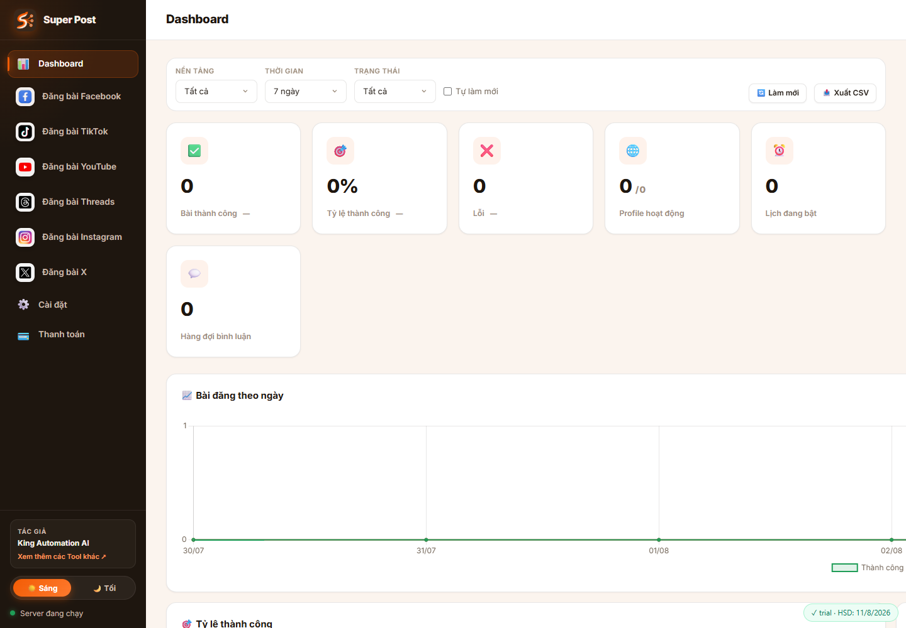
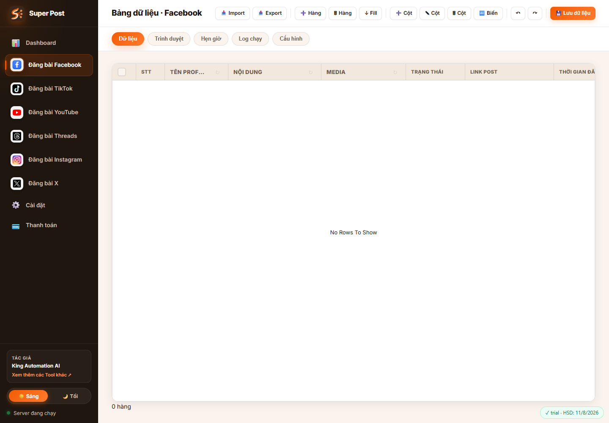
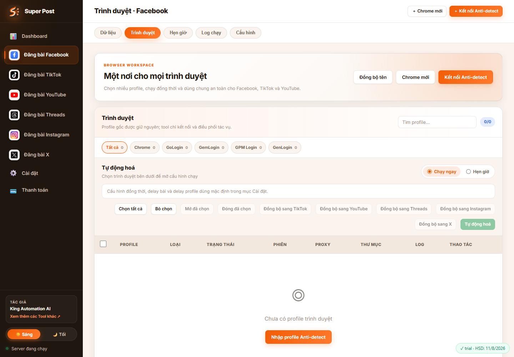
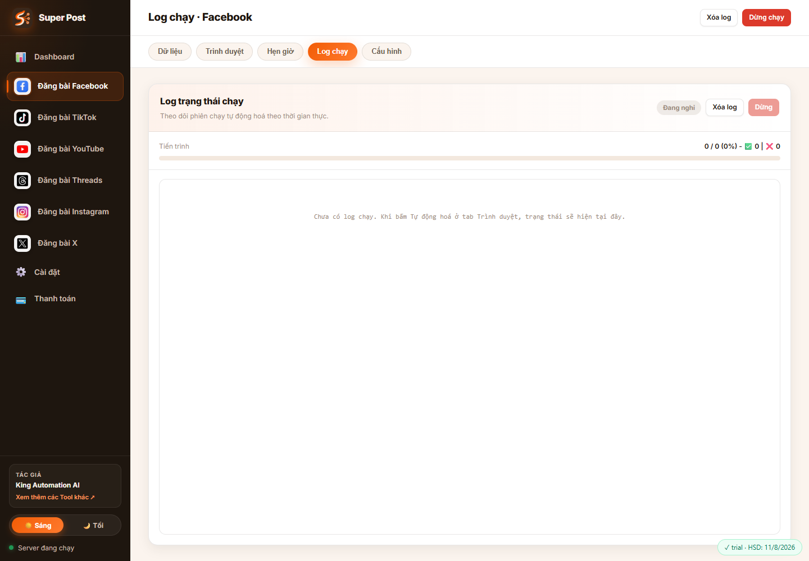
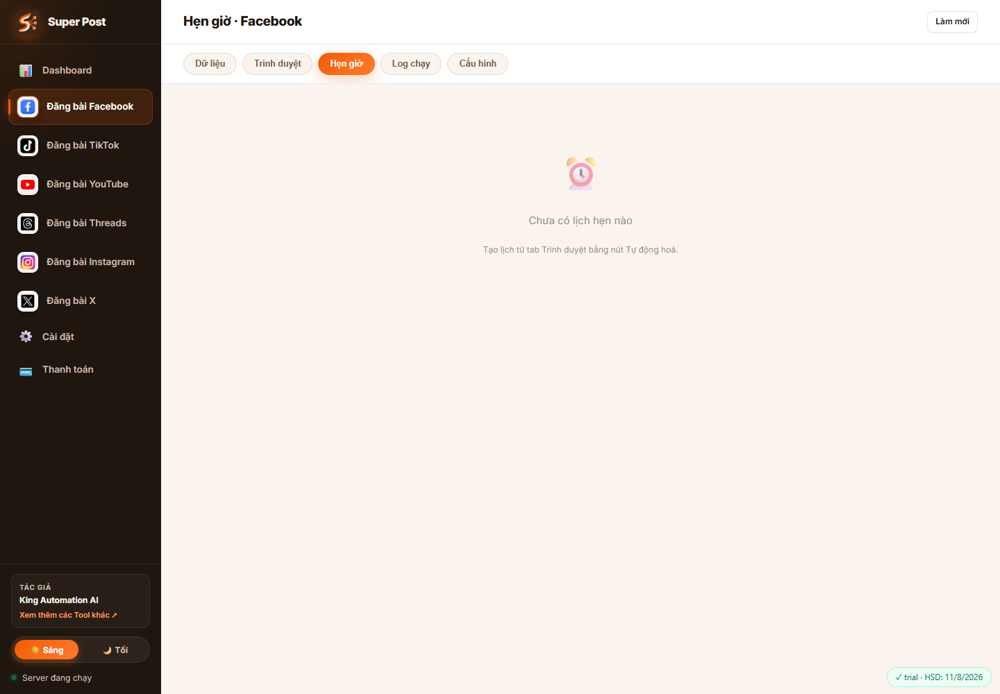
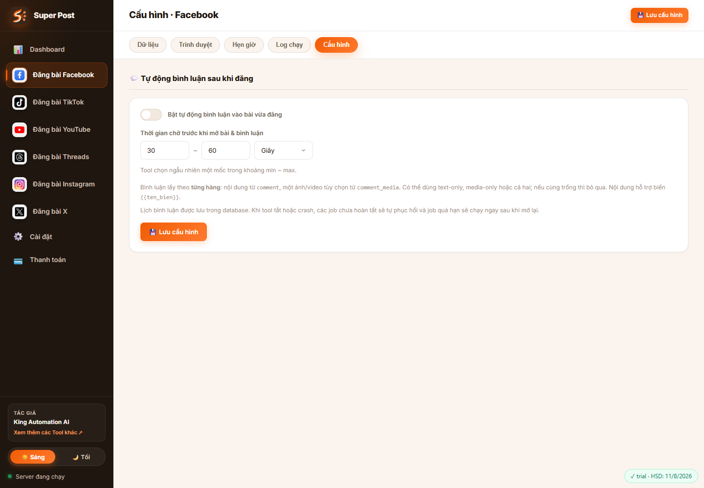
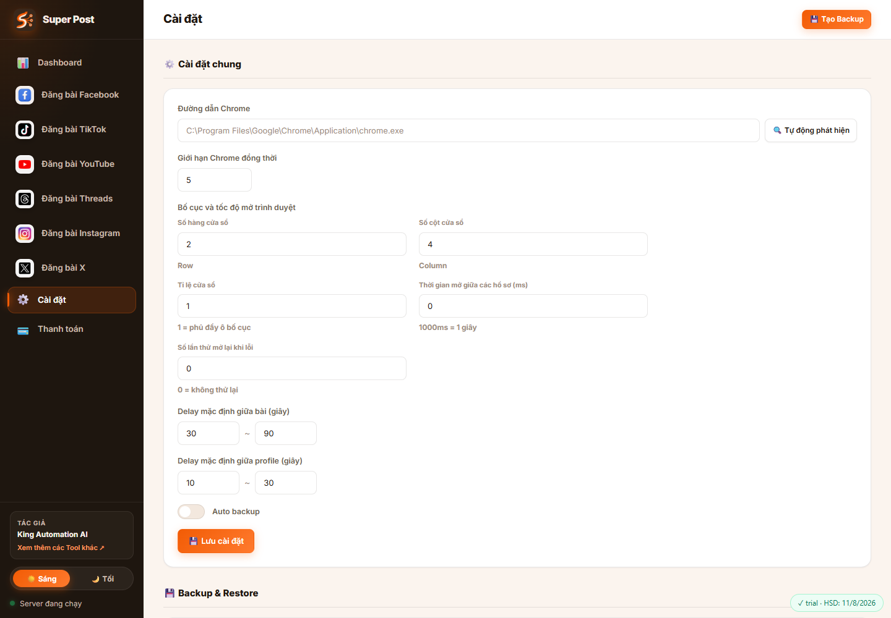
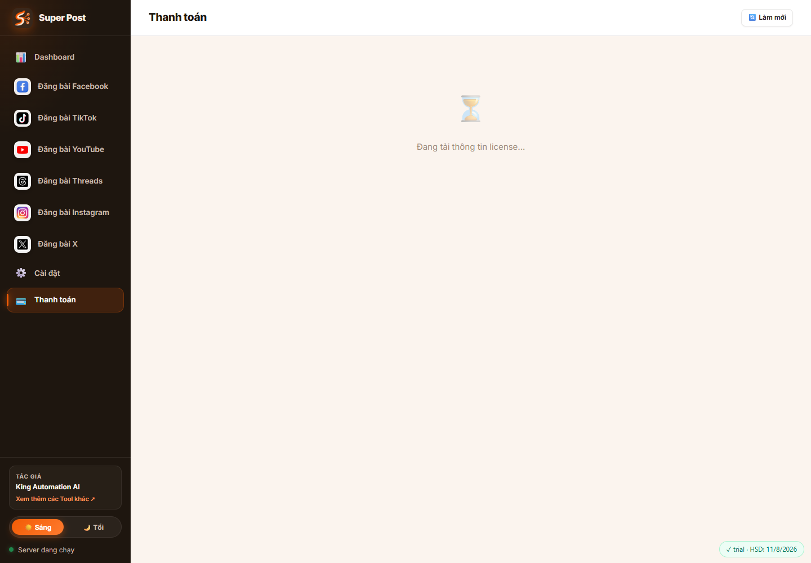

# Hướng Dẫn Sử Dụng Super Post - King

Super Post - King là tool desktop/web để quản lý dữ liệu bài đăng và tự động đăng bài lên Facebook, TikTok, YouTube, Threads, Instagram và X bằng nhiều profile trình duyệt. Tool có bảng dữ liệu kiểu Excel, quản lý profile Chrome/Anti-detect, chạy tự động, hẹn giờ, log realtime, tự lấy link bài, cấu hình bình luận Facebook, thống kê, backup/restore và quản lý license.

## 1. Khởi động tool

### Chế độ web khi chạy từ source

```bash
npm install
npm start
```

Sau khi server chạy, mở:

```text
http://localhost:3000
```

Server chỉ bind local `127.0.0.1`, nên API không mở ra máy khác trong LAN.

### Chế độ desktop

Nếu dùng bản bàn giao Windows, mở ứng dụng đã cài. Dữ liệu người dùng được lưu tại:

```text
%LOCALAPPDATA%\King Automation AI\Super Post King
```

## 2. Tổng quan giao diện

Thanh bên trái có các mục:

- `Dashboard`: thống kê tổng quan.
- `Đăng bài Facebook`, `Đăng bài TikTok`, `Đăng bài YouTube`, `Đăng bài Threads`, `Đăng bài Instagram`, `Đăng bài X`: vào workspace theo từng nền tảng.
- `Cài đặt`: cấu hình Chrome, delay, layout cửa sổ, backup.
- `Thanh toán`: license, gói, nền tảng được cấp quyền.

Khi chọn một nền tảng, phía trên workspace có các tab:

- `Dữ liệu`: bảng bài đăng.
- `Trình duyệt`: profile trình duyệt và nút chạy tự động.
- `Hẹn giờ`: quản lý lịch đã tạo.
- `Log chạy`: theo dõi tiến trình.
- `Cấu hình`: cấu hình tự động bình luận sau khi đăng.



## 3. Quy trình sử dụng chuẩn

1. Vào `Thanh toán`, kích hoạt license hoặc làm mới trạng thái license.
2. Vào `Cài đặt`, kiểm tra đường dẫn Chrome, số Chrome chạy đồng thời, delay và backup.
3. Chọn nền tảng cần đăng ở thanh bên trái.
4. Vào tab `Trình duyệt`, tạo Chrome mới hoặc kết nối profile Anti-detect.
5. Vào tab `Dữ liệu`, nhập bài đăng. Mỗi dòng cần có `Tên Profile` khớp chính xác tên profile trình duyệt và `Trạng thái` là `pending` hoặc `chờ`.
6. Nếu cần bình luận Facebook sau khi đăng, vào tab `Cấu hình` bật tự động bình luận và điền cột `comment`, `comment_media`.
7. Quay lại tab `Trình duyệt`, chọn profile, chọn `Chạy ngay` hoặc `Hẹn giờ`, rồi bấm `Tự động hoá`.
8. Theo dõi ở tab `Log chạy`. Kết quả sẽ được ghi lại vào bảng dữ liệu.

## 4. Dashboard

Dashboard dùng để theo dõi tình hình vận hành:

- Lọc theo nền tảng: tất cả hoặc từng nền tảng.
- Lọc thời gian: hôm nay, 7 ngày, 30 ngày, 90 ngày.
- Lọc trạng thái hoạt động: tất cả, thành công, lỗi, thông tin.
- Bật `Tự làm mới` để dashboard refresh mỗi 30 giây.
- `Xuất CSV` để tải số liệu dashboard.
- Xem KPI: bài thành công, tỷ lệ thành công, lỗi, profile hoạt động, lịch đang bật, hàng đợi bình luận.
- Xem biểu đồ bài theo ngày, tỷ lệ thành công, bài theo nền tảng, kho dữ liệu, profile theo provider.
- Xem cảnh báo mất phiên đăng nhập hoặc lịch quá hạn.

## 5. Bảng dữ liệu



Tab `Dữ liệu` là nơi nhập nội dung bài đăng. Mỗi nền tảng có bảng dữ liệu riêng.

### Các cột quan trọng

| Cột | Biến mặc định | Ý nghĩa |
| --- | --- | --- |
| `Tên Profile` | `{{name_profile}}` | Bắt buộc để runner ghép dòng dữ liệu với đúng profile trình duyệt. Có thể nhập tay hoặc bấm nút chọn profile từ danh sách `Trình duyệt`; giá trị sau khi chọn vẫn là text nên copy/paste/fill xuống bình thường. |
| `Link Fanpage` | `{{link_fanpage}}` | Riêng Facebook. Nếu điền, tool đăng lên Fanpage theo URL này thay vì timeline cá nhân. |
| `Nội dung` | `{{content}}` | Nội dung/caption/tiêu đề tuỳ nền tảng. |
| `Media` | `{{media}}` hoặc `{{image_path}}` | Đường dẫn ảnh/video trên máy. Có thể bấm biểu tượng thư mục để chọn file. |
| `ID_Sản Phẩm` | `{{product_id}}` | Chỉ hiện ở TikTok, dùng để gắn sản phẩm nếu có. |
| `Trạng thái` | `{{status}}` | Dòng được chạy khi là `pending` hoặc `chờ`. Sau khi chạy sẽ thành `success` hoặc `error`. |
| `Link Post` | `{{link_post}}` | Tool tự ghi link bài sau khi đăng. |
| `Thời gian đăng` | `{{time_post}}` | Tool tự ghi thời điểm đăng thành công. |
| `Nội dung bình luận` | `{{comment}}` | Nội dung bình luận sau khi đăng, hiện khi hệ thống tạo cột comment. |
| `Media bình luận` | `{{comment_media}}` | Một ảnh/video cho bình luận Facebook. |
| `Thời gian bình luận` | `{{time_comment}}` | Tool tự ghi thời điểm bình luận thành công. |
| `Trạng thái bình luận` | `{{comment_status}}` | `waiting`, `success`, `error`, `skipped`. |

Lưu ý: cột `Link`, `Nhóm/Trang`, `Ghi chú` được lưu/import/export và có thể dùng cho quản lý dữ liệu hoặc đồng bộ. Các adapter đăng bài hiện tại chủ yếu dùng `content`, `media`, `name_profile`, `status` và các cột riêng theo nền tảng.

### Thao tác dữ liệu

- `Import`: nhập `.xlsx`, `.xls`, `.csv`; chọn sheet và xem trước 5 dòng đầu trước khi nhập.
- `Export`: xuất dữ liệu hiện tại ra Excel.
- `+ Hàng`: thêm dòng mới.
- `Xóa Hàng`: xóa các dòng đang chọn.
- `Fill`: kéo chọn vùng rồi fill giá trị dòng đầu xuống các dòng dưới.
- `Gán profile`: chọn một hoặc nhiều hàng, mở danh sách profile của nền tảng hiện tại rồi gán tên profile vào cột `Tên Profile`.
- `+ Cột`: thêm cột tùy chỉnh.
- `Sửa Cột`: đổi tên/type cột tùy chỉnh.
- `Xóa Cột`: xóa cột tùy chỉnh.
- `Biến`: đổi tên hiển thị và biến `{{ten_bien}}`.
- `Undo/Redo`: hoàn tác hoặc làm lại thao tác dữ liệu.
- `Lưu dữ liệu`: lưu toàn bộ bảng.

Các tính năng cột/biến đang có mật khẩu mở khóa mặc định:

```text
123456
```

### Biến dữ liệu

Nội dung có thể dùng biến theo cú pháp:

```text
Xin chào {{name_profile}}, hôm nay có ưu đãi: {{ma_san_pham}}
```

Khi chạy, tool lấy giá trị của từng dòng để thay vào biến. Tên cột hiển thị và biến có thể khác nhau; runner dùng biến, không dùng tên hiển thị.

### Chọn profile từ danh sách trình duyệt

Trong cột `Tên Profile`, mỗi ô có nút chọn profile. Khi bấm nút này, tool mở popup danh sách profile thuộc nền tảng đang chọn.

Popup hỗ trợ:

- Lọc theo loại profile: `Chrome`, `GoLogin`, `GemLogin`, `GPM Login`, `GenLogin`.
- Lọc theo phiên đăng nhập: tất cả, đã đăng nhập, chưa đăng nhập.
- Tìm theo tên profile, ghi chú, ID profile/provider.
- Chọn 1 profile để ghi tên vào hàng hiện tại hoặc các hàng đang được chọn.

Sau khi chọn, dữ liệu được lưu như text vào `{{name_profile}}`, vì vậy vẫn dùng được copy/paste, kéo vùng và `Fill` để áp dụng xuống nhiều dòng.

### Đồng bộ dữ liệu giữa các cột

Chức năng đồng bộ nằm ngay trên tiêu đề cột trong tab `Dữ liệu`. Những cột có thể đồng bộ sẽ có nút `↻` ở phần header cột.

Quan trọng: đồng bộ hiện tại là đồng bộ một cột từ nền tảng đang mở sang cột cùng biến ở nền tảng khác. Ví dụ cột `Nội dung`/`{{content}}` của Facebook có thể đồng bộ sang cột `Nội dung`/`{{content}}` của TikTok, YouTube, Threads, Instagram hoặc X. Đây không phải chức năng copy tự do từ cột A sang cột B bất kỳ trong cùng một bảng.

#### Cách đồng bộ thủ công

1. Chọn nền tảng nguồn ở sidebar, ví dụ `Đăng bài Facebook`.
2. Vào tab `Dữ liệu`.
3. Tìm cột muốn đồng bộ, ví dụ `Nội dung`, `Media`, `Ghi chú` hoặc cột tùy chỉnh.
4. Bấm nút `↻` trên tiêu đề cột đó.
5. Chọn nền tảng đích cần nhận dữ liệu.
6. Chọn chính sách xử lý dữ liệu:
   - `fill_empty`: chỉ điền vào ô đích đang trống, không ghi đè dữ liệu cũ.
   - `overwrite`: ghi đè dữ liệu đang có ở nền tảng đích.
7. Bật/tắt tùy chọn tạo cột còn thiếu ở nền tảng đích.
8. Bấm xem trước để kiểm tra số dòng sẽ tạo, số ô sẽ cập nhật, số dòng bị bỏ qua.
9. Bấm chạy đồng bộ để ghi dữ liệu thật.

#### Cách bật đồng bộ tự động

1. Bấm `↻` trên cột nguồn.
2. Chọn các nền tảng đích.
3. Bật đồng bộ tự động cho cột đó.
4. Lưu cấu hình.

Từ lần sau, khi sửa dữ liệu trong cột nguồn, tool sẽ tự đồng bộ sang nền tảng đích theo rule đã lưu. Nút `↻` sẽ có trạng thái khác để báo cột đang bật auto sync.

#### Cách tool ghép dòng khi đồng bộ

Tool dùng `sync_key` ẩn để ghép dòng giữa các nền tảng. Khi một dòng nguồn chưa có dòng tương ứng ở nền tảng đích, tool có thể tạo dòng mới nếu tùy chọn tạo dòng/cột còn thiếu đang bật. Dòng mới ở nền tảng đích được tạo với trạng thái `pending`.

#### Cột được và không được đồng bộ

Có thể đồng bộ:

- `Nội dung` (`{{content}}`)
- `Media` (`{{image_path}}` hoặc `{{media}}`)
- `Nhóm/Trang` (`{{target}}`)
- `Ghi chú` (`{{note}}`)
- `ID_Sản Phẩm` (`{{product_id}}`) khi nền tảng đích hỗ trợ TikTok
- Cột tùy chỉnh có cùng biến `var_key`

Không đồng bộ các cột kết quả/chạy tự động:

- `status`
- `link`
- `link_fanpage`
- `link_post`
- `time_post`
- `time_comment`
- `comment_status`

Các cột này bị chặn để tránh ghi đè trạng thái chạy, link kết quả hoặc dữ liệu điều hướng riêng của từng nền tảng.

#### Hoàn tác đồng bộ

Sau một lần đồng bộ, tool lưu lịch sử chạy. Có thể dùng `Undo` trong màn hình đồng bộ để:

- Khôi phục giá trị cũ nếu dòng đích đã tồn tại trước đó.
- Xóa dòng đích nếu dòng đó được tạo mới bởi lần đồng bộ vừa chạy.

Undo chỉ nên dùng ngay sau khi phát hiện đồng bộ sai, trước khi tiếp tục sửa dữ liệu ở nền tảng đích.

## 6. Yêu cầu dữ liệu theo từng nền tảng

### Facebook

- Profile phải còn phiên đăng nhập Facebook hợp lệ.
- Nếu `Link Fanpage` trống, tool đăng lên timeline của tài khoản đang đăng nhập trong profile.
- Nếu `Link Fanpage` có dữ liệu, tool chuyển tới Fanpage đó và đăng lên Fanpage. URL hợp lệ là link `facebook.com` của Fanpage hoặc dạng `profile.php?id=...`; không dùng link group, bài viết, reel, story, photo, video cụ thể.
- Nên có `Nội dung` hoặc `Media`.
- `Media` có thể là ảnh/video; nhiều file cách nhau bằng dấu phẩy.
- Sau khi đăng, tool cố lấy permalink Facebook và ghi vào `Link Post`; nếu chưa lấy được link thì trạng thái vẫn có thể là `success`, nhưng `Link Post` trống và note ghi chưa lấy được link.
- Tự động bình luận sau khi đăng hiện được implement cho Facebook.

### TikTok

- Profile phải còn phiên đăng nhập TikTok.
- Bắt buộc có đúng 1 video trong `Media`.
- Định dạng video hỗ trợ: `mp4`, `mov`, `m4v`, `avi`, `mkv`, `webm`, `wmv`, `mpeg`, `mpg`, `3gp`.
- `Nội dung` dùng làm caption.
- `ID_Sản Phẩm` là tùy chọn; nếu điền, tool tìm và gắn sản phẩm trong TikTok Studio.
- Tool chờ mục kiểm tra nội dung nhanh báo an toàn trước khi bấm đăng.

### YouTube

- Profile phải còn phiên đăng nhập YouTube/Google.
- Bắt buộc có tiêu đề trong `Nội dung`.
- Bắt buộc có video hợp lệ trong `Media`.
- Cột riêng của YouTube:
  - `Mô tả video` (`{{description}}`)
  - `Tên kênh` (`{{channel_name}}`)
  - `Danh sách phát` (`{{playlist}}`)
  - `Trạng thái lưu` (`{{privacy_status}}`): `Không công khai`, `Riêng tư`, `Công khai`
  - `Hình Thumbnail` (`{{thumbnail}}`)
  - `Từ khóa` (`{{keywords}}`)
- Tool tự chọn mục không dành cho trẻ em, đi qua các bước Next và xuất bản/lưu theo trạng thái đã chọn.

### Threads

- Profile phải còn phiên đăng nhập Threads/Instagram.
- Mỗi dòng cần có `Nội dung` hoặc `Media`.
- Media hỗ trợ ảnh, gif và video phổ biến.
- Tool tìm profile đang đăng nhập, snapshot bài cũ, đăng bài mới và lấy permalink `/@user/post/...`.

### Instagram

- Profile phải còn phiên đăng nhập Instagram.
- Bắt buộc có `Media`; caption là tùy chọn.
- Media hỗ trợ ảnh/video phổ biến và phải lớn hơn 1 KB.
- Tool bấm `Create`, tải media, bấm `Next` hai lần, nhập caption, bấm `Share`, rồi lấy link bài mới.

### X

- Profile phải còn phiên đăng nhập X/Twitter.
- Mỗi dòng cần có `Nội dung` hoặc `Media`.
- Media hỗ trợ `jpg`, `jpeg`, `png`, `webp`, `gif`, `bmp`, `mp4`, `mov`, `m4v`, `webm`.
- Tool phát hiện tài khoản bị suspended/locked hoặc lỗi tạm thời khi post.
- Link kết quả có dạng `https://x.com/username/status/id`.

## 7. Quản lý trình duyệt



Tab `Trình duyệt` quản lý profile dùng để đăng bài.

### Tạo Chrome mới

1. Bấm `Chrome mới`.
2. Nhập `Tên Profile`.
3. Chọn proxy nếu cần:
   - Không dùng proxy
   - HTTP/HTTPS
   - SOCKS5
4. Nhập host, port, username, password nếu dùng proxy.
5. Bấm `Tạo Profile`.
6. Bấm `Mở`, đăng nhập nền tảng cần dùng trong cửa sổ Chrome đó.

### Kết nối Anti-detect

Bấm `Kết nối Anti-detect`, chọn provider:

- `GoLogin`: dùng thư mục profile và executable gốc.
- `GemLogin`: có thể dùng Local API mặc định `http://127.0.0.1:1010/api`, thư mục profile, executable, extension.
- `GPM Login`: dùng Local API mặc định `http://127.0.0.1:9495/api/v1`.
- `GenLogin`: dùng Local API mặc định `http://127.0.0.1:55550/backend/profiles`, có thể nhập Bearer token.

Sau đó:

1. Bấm `Quét profile`.
2. Chọn profile tìm được.
3. Chọn nền tảng sẽ dùng profile đó.
4. Bấm `Nhập profile đã chọn`.

Tool chỉ kết nối/điều phối profile gốc, không sao chép cookie/fingerprint. Với profile ngoài, nếu đang mở thủ công thì nên đóng trước khi tool mở, hoặc nhập CDP endpoint trong màn hình sửa.

### Thao tác hàng loạt

- Chọn từng profile hoặc `Chọn tất cả`.
- `Mở đã chọn`: mở nhiều profile theo giới hạn trong Cài đặt.
- `Đóng đã chọn`: đóng/detach nhiều profile.
- `Đồng bộ sang ...`: gán cùng profile vật lý sang nền tảng khác.
- `Đồng bộ tên`: đọc lại tên authoritative từ provider Anti-detect.
- `Log`: xem log gần đây của profile.
- `Sửa`: đổi tên, proxy hoặc cấu hình external.
- `Xóa`: bỏ liên kết profile khỏi nền tảng hiện tại; profile ngoài không bị xóa khỏi phần mềm Anti-detect.

## 8. Chạy tự động

Chạy tự động được thao tác nhanh nhất từ tab `Trình duyệt`.

1. Chọn nền tảng ở sidebar.
2. Vào `Trình duyệt`.
3. Chọn profile cần chạy.
4. Chọn `Chạy ngay`.
5. Bấm `Tự động hoá`.

Runner chỉ lấy các dòng dữ liệu thỏa cả hai điều kiện:

- `Trạng thái` là `pending` hoặc `chờ`.
- `{{name_profile}}` khớp chính xác với tên profile đã chọn.

Khi chạy:

- Nhiều profile chạy song song theo giới hạn concurrency.
- Các tác vụ trên cùng một profile vật lý được xếp hàng tuần tự để tránh hai thao tác cùng điều khiển một cửa sổ.
- Delay giữa bài và delay giữa profile lấy theo cấu hình mặc định trong `Cài đặt`.
- Kết quả được ghi vào `Trạng thái`, `Ghi chú`, `Link Post`, `Thời gian đăng`.

## 9. Log chạy



Tab `Log chạy` hiển thị realtime qua WebSocket:

- Trạng thái đang chạy/đang nghỉ.
- Tiến trình tổng số bài, thành công, lỗi.
- Log theo profile và hệ thống.
- `Xóa log`: xóa log hiển thị của nền tảng đang chọn.
- `Dừng`: yêu cầu runner dừng sau khi tác vụ hiện tại hoàn tất.

## 10. Hẹn giờ



Tạo lịch từ tab `Trình duyệt`:

1. Chọn profile.
2. Chọn chế độ `Hẹn giờ`.
3. Nhập tên lịch.
4. Chọn kiểu lịch:
   - `Một lần`: chọn ngày giờ cụ thể.
   - `Hàng ngày`: chọn giờ chạy mỗi ngày.
   - `Cron`: nhập cron expression, ví dụ `0 8 * * *`.
5. Bấm `Tự động hoá`.

Tab `Hẹn giờ` dùng để:

- Xem tên lịch, loại lịch, trạng thái, thời gian, số profile, lần chạy cuối.
- Bật/tắt lịch.
- Sửa lịch.
- Xóa lịch.
- Làm mới danh sách.

Lịch được lưu trong database và tự khôi phục khi mở lại tool.

## 11. Cấu hình bình luận sau khi đăng



Tab `Cấu hình` hiện có chức năng tự động bình luận sau khi đăng.

1. Bật `Bật tự động bình luận vào bài vừa đăng`.
2. Nhập khoảng chờ min/max.
3. Chọn đơn vị `Giây` hoặc `Phút`.
4. Bấm `Lưu cấu hình`.
5. Trong bảng dữ liệu, điền:
   - `comment`: nội dung bình luận.
   - `comment_media`: một ảnh/video nếu cần.

Tool chọn ngẫu nhiên một mốc trong khoảng min/max. Job bình luận được lưu trong database; nếu tool tắt hoặc crash, job chưa hoàn tất sẽ được khôi phục khi mở lại.

Lưu ý quan trọng: adapter bình luận hiện được implement cho Facebook. Các nền tảng khác có cột/trạng thái comment nhưng script comment đang trả lỗi chưa cấu hình.

## 12. Cài đặt và Backup



Tab `Cài đặt` gồm:

- `Đường dẫn Chrome`: đường dẫn `chrome.exe`. Có nút `Tự động phát hiện` để điền path mặc định.
- `Giới hạn Chrome đồng thời`: số profile Chrome được mở/chạy cùng lúc.
- `Số hàng cửa sổ`, `Số cột cửa sổ`: bố cục sắp xếp cửa sổ Chrome.
- `Tỉ lệ cửa sổ`: `1` là phủ đầy ô bố cục, thấp hơn thì cửa sổ nhỏ hơn.
- `Thời gian mở giữa các hồ sơ (ms)`: delay khi mở nhiều profile.
- `Số lần thử mở lại khi lỗi`: số lần retry khi mở browser thất bại.
- `Delay mặc định giữa bài`: khoảng delay giữa các bài trong cùng profile.
- `Delay mặc định giữa profile`: khoảng delay trước khi khởi chạy profile kế tiếp.
- `Auto backup`: bật backup tự động nếu cần.
- `Tạo Backup`: tạo file backup thủ công.
- `Khôi phục`: restore từ backup đã tạo.
- `Xóa`: xóa file backup.

Trước khi restore, nên tạo backup mới vì restore sẽ ghi đè dữ liệu hiện tại.

## 13. Thanh toán và License



Tab `Thanh toán` dùng để:

- Xem trạng thái license.
- Xem gói hiện tại, ngày hết hạn, thời hạn còn lại.
- Xem nền tảng được cấp quyền.
- Copy mã máy `HWID`.
- Kích hoạt bằng web hoặc nhập license key.
- Làm mới trạng thái license.
- Xem lịch sử đơn hàng.

Runner kiểm tra license trước khi chạy. Nếu license hết hạn hoặc nền tảng chưa được cấp quyền, tool sẽ không bắt đầu chạy nền tảng đó.

## 14. Import Excel đúng định dạng

Tool tự map các tên cột phổ biến:

- `content`, `nội dung`, `bài viết`, `text` -> `Nội dung`
- `image_path`, `hình ảnh`, `ảnh`, `image`, `file` -> `Media`
- `product_id`, `id sản phẩm`, `mã sản phẩm` -> `ID_Sản Phẩm`
- Riêng Facebook: `link_fanpage`, `link fanpage`, `fanpage`, `fanpage link`, `link trang` -> `Link Fanpage`
- `link`, `url`, `đường dẫn` -> `Link`
- `target`, `nhóm`, `trang`, `group`, `page` -> `Nhóm/Trang`
- `status`, `trạng thái` -> `Trạng thái`
- `note`, `ghi chú`, `notes` -> `Ghi chú`

Nếu file không có header khớp, tool map theo thứ tự cột: nội dung, media, product_id nếu là TikTok, link, target, note.

## 15. Lỗi thường gặp

### Bấm chạy nhưng báo không có dữ liệu phù hợp

Kiểm tra:

- Dòng cần chạy có `Trạng thái` là `pending` hoặc `chờ`.
- Cột `Tên Profile`/`{{name_profile}}` đã có giá trị.
- Giá trị `Tên Profile` khớp chính xác tên profile trong tab `Trình duyệt`.
- Bạn đang ở đúng nền tảng; dữ liệu mỗi nền tảng tách riêng.

### Không mở được Chrome

Kiểm tra:

- `Cài đặt` -> `Đường dẫn Chrome`.
- Proxy host/port/user/pass.
- Profile Anti-detect có đang mở thủ công không.
- Local API của GPM/GemLogin/GenLogin đã bật chưa.
- Với phiên đang mở sẵn, nhập đúng CDP endpoint.

### Báo chưa đăng nhập

Mở profile thủ công bằng nút `Mở`, đăng nhập lại nền tảng, sau đó chạy lại. Tool kiểm tra cookie phiên đăng nhập của từng nền tảng.

### Báo không tìm thấy media

Kiểm tra đường dẫn file tuyệt đối trong cột `Media` hoặc `comment_media`. Nếu nhiều file, tách bằng dấu phẩy.

### TikTok không đăng vì kiểm tra nội dung

TikTok Studio báo nội dung có thể bị hạn chế hoặc chưa có trạng thái an toàn. Sửa caption/video rồi chạy lại.

### YouTube không tìm thấy kênh

Kiểm tra cột `Tên kênh`. Có thể bỏ trống nếu profile chỉ dùng một kênh mặc định.

### Đăng thành công nhưng chưa có Link Post

Một số nền tảng cập nhật permalink chậm. Facebook video có thể chuyển thành Reel. Tool vẫn ghi `success` nếu đăng thành công, nhưng `Link Post` có thể trống nếu chưa xác định được link.

### Bình luận bị `skipped`

Các nguyên nhân thường gặp:

- Tự động bình luận đang tắt.
- Cả `comment` và `comment_media` đều trống.
- Bài đăng chưa lấy được permalink.

### Bình luận bị `error`

Kiểm tra:

- Link bài đã có trong `Link Post`.
- Profile còn đăng nhập Facebook.
- File `comment_media` tồn tại và đúng định dạng.
- Bài viết cho phép bình luận.

## 16. Lưu ý bảo mật và vận hành

- Không chia sẻ thư mục profile Chrome vì có cookie đăng nhập.
- Không commit file `.db`, `src/chrome-profiles`, `uploads`, `dist`, token hoặc secret.
- Nên backup trước khi import dữ liệu lớn hoặc restore.
- Không mở cùng một profile bằng nhiều tool cùng lúc.
- Dữ liệu đăng bài mỗi nền tảng được tách riêng, cần kiểm tra đúng nền tảng trước khi nhập/chạy.

## 17. Màu sắc, font chữ và size giao diện

Các thông số dưới đây lấy từ file `public/css/style.css`.

### Font chữ

Font chính của tool:

```css
font-family: 'Inter', -apple-system, BlinkMacSystemFont, sans-serif;
```

Tool đang tải font Inter từ Google Fonts, có hỗ trợ tiếng Việt:

```html
https://fonts.googleapis.com/css2?family=Inter:wght@300;400;500;600;700;800&display=swap&subset=vietnamese,latin-ext
```

Font fallback:

- `-apple-system`
- `BlinkMacSystemFont`
- `sans-serif`

### Size chữ nền tảng

| Thành phần | Size | Weight | Ghi chú |
| --- | ---: | ---: | --- |
| Body/base text | `14px` | mặc định | `line-height: 1.6` |
| Brand text sidebar | `16px` | `800` | Chữ `Super Post` |
| Menu sidebar | `13.5px` | `600` | Các mục Dashboard/nền tảng |
| Icon menu sidebar | `18px` | - | Icon bên trái menu |
| Page title | `19px` | `800` | Tiêu đề trang, ví dụ `Bảng dữ liệu · Facebook` |
| Workspace tab | `12.5px` | `700` | Tab `Dữ liệu`, `Trình duyệt`, `Hẹn giờ` |
| Button mặc định | `13px` | `600` | `.btn` |
| Button nhỏ | `12px` | - | `.btn-sm` |
| Button lớn | `15px` | - | `.btn-lg` |
| Form label | `12.5px` | `600` | Nhãn input |
| Input/select/textarea | `13px` | mặc định | Ô nhập liệu |
| Card title | `15px` | `700` | Tiêu đề card |
| KPI value | `30px` | `800` | Số lớn trên Dashboard |
| KPI label | `12.5px` | `600` | Nhãn KPI |
| Badge trạng thái | `11.5px` | `700` | `success`, `error`, `pending` |
| Browser name | `15px` | `700` | Tên profile trình duyệt |
| Browser hero title | `23px` | mặc định | Tiêu đề khối Trình duyệt |
| Browser hero subtitle | `12.5px` | mặc định | Mô tả dưới hero |
| Provider filter | `11.5px` | `700` | Bộ lọc Chrome/GoLogin/GPM... |
| Provider badge | `10.5px` | `800` | Nhãn provider |
| Bảng AG Grid | `13px` | mặc định | Dữ liệu trong bảng |
| Bảng thường header | `11.5px` | `800` | Header table uppercase |
| Bảng thường cell | `12.5px` | mặc định | Cell table |
| Log/profile note text | `11.5px` | mặc định | Text phụ, đường dẫn, note |
| Help/hint text | `10.5px` | `500` | Gợi ý nhỏ |

### Mã màu thương hiệu

| Tên | Mã màu |
| --- | --- |
| Nâu đậm | `#1E160F` |
| Kem nền | `#FBF4EE` |
| Trắng | `#FFFFFF` |
| Cam thương hiệu | `#F25C05` |

### Light theme

| Token | Mã màu |
| --- | --- |
| `--bg-primary` | `#FBF4EE` |
| `--bg-secondary` | `#FFFFFF` |
| `--bg-tertiary` | `#F3E8DE` |
| `--bg-card` | `#FFFFFF` |
| `--bg-card-hover` | `#FCF7F2` |
| `--bg-input` | `#FFFFFF` |
| `--bg-sidebar` | `#1E160F` |
| `--sidebar-text` | `#C9BCAE` |
| `--sidebar-text-hover` | `#FBF4EE` |
| `--text-primary` | `#1E160F` |
| `--text-secondary` | `#6B5D4F` |
| `--text-muted` | `#9C8C7B` |
| `--text-white` | `#FFFFFF` |
| `--accent` | `#F25C05` |
| `--accent-hover` | `#FF6E1E` |
| `--accent-press` | `#D64E00` |

### Dark theme

| Token | Mã màu |
| --- | --- |
| `--bg-primary` | `#15100B` |
| `--bg-secondary` | `#1C150E` |
| `--bg-tertiary` | `#2A2016` |
| `--bg-card` | `#211812` |
| `--bg-card-hover` | `#2A2016` |
| `--bg-input` | `#1B140D` |
| `--bg-sidebar` | `#100B07` |
| `--sidebar-text` | `#B5A897` |
| `--sidebar-text-hover` | `#FBF4EE` |
| `--text-primary` | `#FBF4EE` |
| `--text-secondary` | `#C3B4A4` |
| `--text-muted` | `#8C7D6D` |
| `--text-white` | `#FFFFFF` |
| `--accent` | `#F97316` |
| `--accent-hover` | `#FB8A3C` |
| `--accent-press` | `#EA6407` |

### Màu trạng thái

| Trạng thái | Light | Dark |
| --- | --- | --- |
| Success | `#1F9D57` | `#34C56E` |
| Warning | `#C77800` | `#E7A33E` |
| Error | `#DC3A2B` | `#F26555` |
| Info | `#2563EB` | `#5B8DEF` |

### Radius và layout size chính

| Token | Giá trị |
| --- | ---: |
| Sidebar width | `232px` |
| Header height | `64px` |
| Small radius | `8px` |
| Medium radius | `12px` |
| Large radius | `16px` |
| Extra large radius | `22px` |
