# HƯỚNG DẪN SỬ DỤNG SUPER POST KING

**Đăng bài đa nền tảng - Quản lý profile - AI nội dung - Đồng bộ dữ liệu**

Cập nhật: 17/08/2026

Tài liệu dành cho người mới sử dụng. Mỗi phần chỉ hướng dẫn thao tác trên màn
hình, không trình bày cách tool được xây dựng.

---

## Đọc nhanh trước khi bắt đầu

Trong tài liệu này, **profile** là một cửa sổ trình duyệt đã dùng để đăng nhập
tài khoản Facebook, TikTok, YouTube hoặc nền tảng khác.

Quy trình sử dụng chung:

1. Thêm profile tại mục **Trình duyệt**.
2. Mở profile và đăng nhập tài khoản cần sử dụng.
3. Vào nền tảng cần đăng bài.
4. Nhập dữ liệu vào từng hàng.
5. Đặt **Trạng thái** của hàng cần chạy là **Chờ**.
6. Bấm **Tự động hóa**, chọn profile và chọn **Chạy ngay** hoặc **Hẹn giờ**.
7. Theo dõi kết quả tại **Log chạy** và cột **Link Post**.

> Quan trọng: Tên trong cột **Tên Profile** phải giống đúng tên profile tại mục
> **Trình duyệt**. Tool chỉ chạy các hàng đang ở trạng thái **Chờ**.

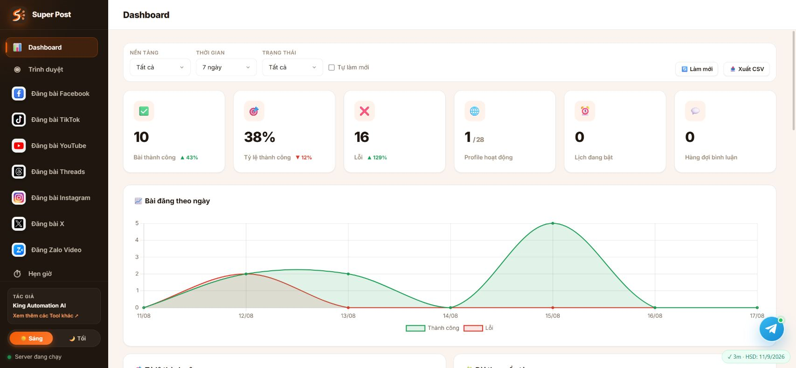

---

## 1. Dashboard

Dashboard giúp xem nhanh tình hình hoạt động của toàn bộ tool.

### Thông tin hiển thị

- Số bài đăng thành công.
- Tỷ lệ thành công.
- Số bài lỗi.
- Số profile đang hoạt động.
- Số lịch đang bật.
- Số bình luận đang chờ.
- Biểu đồ theo ngày và theo nền tảng.
- Lịch sắp chạy và hoạt động gần đây.

### Cách sử dụng

1. Chọn **Nền tảng** nếu chỉ muốn xem Facebook, TikTok hoặc một nền tảng cụ thể.
2. Chọn khoảng thời gian: hôm nay, 7 ngày, 30 ngày hoặc 90 ngày.
3. Chọn trạng thái cần xem.
4. Bật **Tự làm mới** nếu muốn số liệu cập nhật liên tục.
5. Bấm **Xuất CSV** khi cần lưu báo cáo.

---

## 2. Trình duyệt và profile

Tất cả profile được quản lý chung tại một nơi. Sau khi thêm profile, người dùng
có thể dùng profile đó cho bất kỳ nền tảng nào đã đăng nhập.

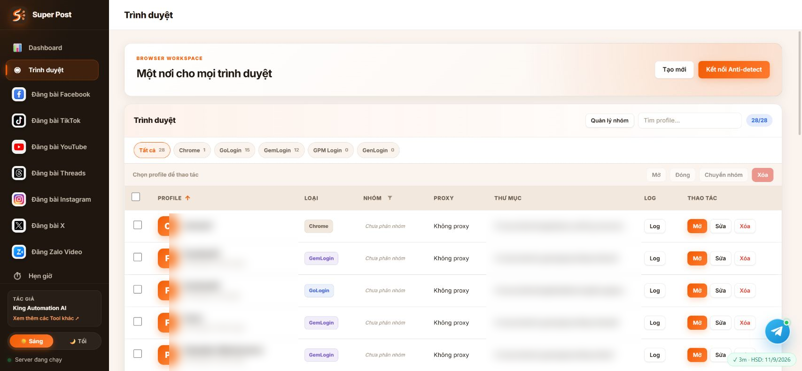

### 2.1. Tạo profile Chrome mới

1. Vào **Trình duyệt**.
2. Bấm **Tạo mới**.
3. Nhập tên dễ nhớ, ví dụ `Facebook 01` hoặc `Kênh TikTok A`.
4. Nếu không dùng proxy, giữ **Không dùng proxy**.
5. Nếu có proxy, chọn loại proxy và nhập thông tin được cung cấp.
6. Có thể nhập ghi chú để dễ phân biệt.
7. Bấm **Tạo Profile**.
8. Bấm **Mở** và đăng nhập tài khoản trong cửa sổ vừa tạo.

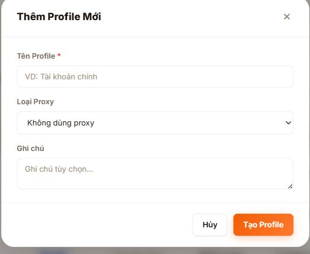

> Nên đặt tên profile ngắn, không trùng nhau. Không đổi tên profile khi đang có
> dữ liệu chờ chạy với tên cũ.

### 2.2. Kết nối trình duyệt Anti-detect

Tool hỗ trợ GoLogin, GemLogin, GPM Login và GenLogin.

1. Đóng profile đang mở thủ công trong ứng dụng Anti-detect.
2. Tại mục **Trình duyệt**, bấm **Kết nối Anti-detect**.
3. Chọn đúng loại trình duyệt.
4. Kiểm tra các ô thông tin đang hiển thị.
5. Bấm **Quét profile**.
6. Tích các profile cần thêm hoặc dùng **Chọn tất cả**.
7. Bấm **Nhập profile đã chọn**.

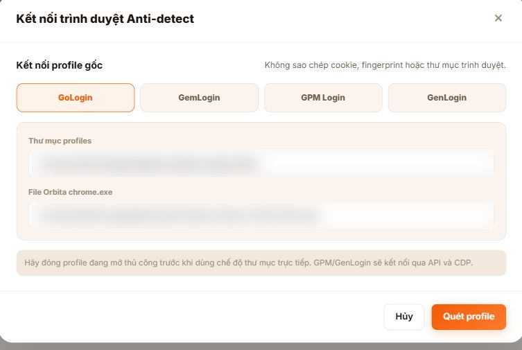

> Tool lấy toàn bộ danh sách tìm được, không giới hạn 50 profile. Với 200 hoặc
> 500 profile, người dùng vẫn có thể lấy hết rồi tự chọn profile cần dùng.

### 2.3. Tạo và quản lý nhóm

Một profile có thể thuộc một hoặc nhiều nhóm.

1. Bấm **Quản lý nhóm**.
2. Nhập tên nhóm, ví dụ `Khách A`, `Facebook`, `TikTok Shop`.
3. Bấm **Tạo nhóm**.
4. Muốn đổi tên nhóm, sửa tên rồi bấm **Lưu**.
5. Muốn xóa nhóm, bấm **Xóa**.

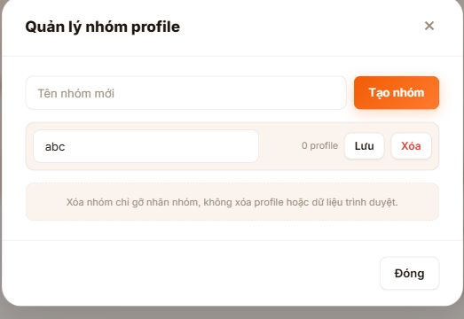

Xóa nhóm chỉ bỏ nhãn nhóm, không xóa profile và không xóa dữ liệu đăng nhập.

### 2.4. Đưa profile vào nhóm

1. Bấm vào tên nhóm tại hàng profile cần chỉnh.
2. Tích một hoặc nhiều nhóm.
3. Bấm **Lưu nhóm**.

Để chuyển nhiều profile cùng lúc:

1. Tích các profile.
2. Bấm **Chuyển nhóm**.
3. Chọn cách thêm nhóm hoặc thay thế nhóm hiện tại.
4. Chọn nhóm rồi bấm **Áp dụng**.

### 2.5. Tìm, lọc và sắp xếp

- Gõ tên vào ô **Tìm profile** để tìm nhanh.
- Bấm các thẻ **Chrome**, **GoLogin**, **GemLogin**, **GPM Login** hoặc
  **GenLogin** để lọc theo loại.
- Bấm biểu tượng lọc cạnh cột **Nhóm** để lọc một hoặc nhiều nhóm.
- Bấm mũi tên cạnh **Profile** để sắp xếp tên tăng hoặc giảm.

### 2.6. Mở, đóng, sửa và xóa profile

- **Mở**: mở cửa sổ trình duyệt của profile.
- **Đóng**: đóng cửa sổ đang mở.
- **Sửa**: đổi tên, proxy hoặc ghi chú.
- **Log**: xem hoạt động riêng của profile.
- **Xóa**: xóa profile khỏi danh sách tool.

Khi thao tác nhiều profile, tích các hàng rồi dùng nút **Mở**, **Đóng**,
**Chuyển nhóm** hoặc **Xóa** ở phía trên bảng.

> Trước khi xóa profile, hãy chắc chắn không còn hàng đang chờ dùng tên profile
> đó. Với profile Anti-detect, xóa trong tool không có nghĩa là xóa profile gốc
> trong ứng dụng Anti-detect.

---

## 3. Bảng dữ liệu đăng bài

Mỗi nền tảng có một bảng riêng. Các nút thao tác giống nhau, còn một số cột sẽ
thay đổi theo nền tảng.

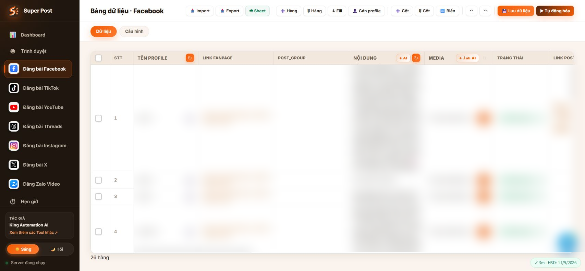

### 3.1. Ý nghĩa các cột chung

- **STT**: thứ tự hàng.
- **Tên Profile**: profile sẽ dùng để đăng bài.
- **Nội dung**: nội dung bài đăng; với YouTube đây là tiêu đề video.
- **Media**: hình hoặc video trên máy.
- **Trạng thái**: Chờ, Đang chạy, Thành công, Lỗi hoặc Bỏ qua.
- **Link Post**: tool tự điền link sau khi đăng thành công.
- **Thời gian đăng**: thời điểm đăng thành công.
- **Bình luận 1**: nội dung bình luận sau khi đăng.
- **Media bình luận 1**: hình hoặc video dùng cho bình luận nếu nền tảng hỗ trợ.
- **Thời gian bình luận 1**: tool tự điền sau khi gửi.
- **Trạng thái bình luận 1**: kết quả của bình luận.

Các cột mặc định được giữ cố định để tool hoạt động đúng.

### 3.2. Nhập và sửa dữ liệu

1. Bấm **+ Hàng** để thêm hàng mới.
2. Bấm vào ô cần nhập.
3. Nhập nội dung hoặc dán dữ liệu.
4. Tại cột **Media**, bấm biểu tượng thư mục để chọn file.
5. Tại cột **Trạng thái**, chọn **Chờ** cho hàng cần chạy.
6. Bấm **Lưu dữ liệu**.

Để chọn một vùng giống bảng tính:

- Kéo chuột qua nhiều ô để chọn vùng.
- Dùng `Ctrl+C` để sao chép.
- Dùng `Ctrl+V` để dán.
- Dùng phím `Delete` để xóa nội dung vùng đã chọn.
- Dùng nút mũi tên quay lại hoặc tiến tới để hoàn tác và làm lại.

### 3.3. Chọn media

1. Bấm biểu tượng thư mục trong ô **Media**.
2. Chọn đúng file hình hoặc video.
3. Kiểm tra tên file đã xuất hiện trong ô.
4. Bấm **Lưu dữ liệu**.

Nếu cần nhiều file trong một bài ở nền tảng có hỗ trợ, có thể dán các đường dẫn
và ngăn cách bằng dấu phẩy.

### 3.4. Gán profile cho một hoặc nhiều hàng

1. Tích các hàng cần gán.
2. Bấm **Gán profile**.
3. Lọc theo loại trình duyệt hoặc tìm theo tên.
4. Bấm profile muốn sử dụng.
5. Kiểm tra tên đã được điền vào bảng.

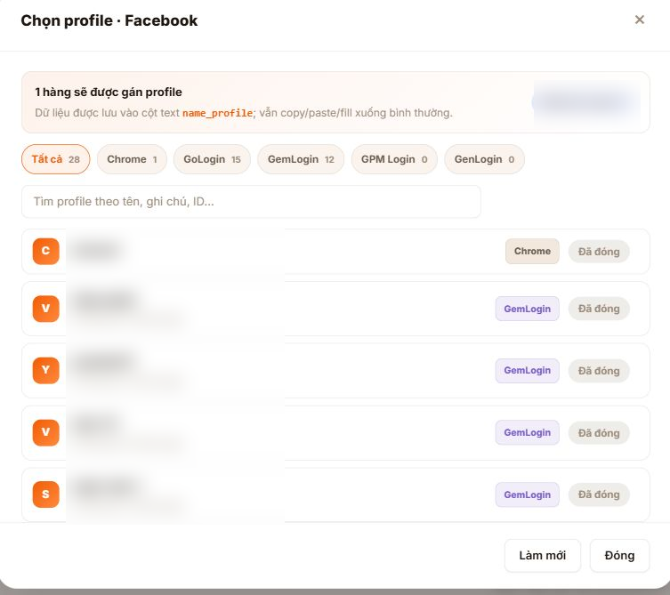

Tên profile được lưu trực tiếp vào các hàng đã chọn.

### 3.5. Fill dữ liệu xuống nhiều hàng

1. Chọn ô có nội dung mẫu và các ô phía dưới cần điền.
2. Bấm **Fill**.
3. Tool sao chép nội dung của ô đầu tiên xuống các hàng đã chọn.

Chức năng này phù hợp khi nhiều hàng dùng chung profile, link trang hoặc một
phần nội dung.

### 3.6. Thêm và xóa hàng

- Bấm **+ Hàng** để tạo hàng mới.
- Tích các hàng rồi bấm **Xóa Hàng** để xóa.
- Sau khi thao tác, bấm **Lưu dữ liệu**.

### 3.7. Thêm cột riêng

1. Bấm **+ Cột**.
2. Chọn loại cột phù hợp.
3. Nhập tên cột.
4. Bấm **Thêm cột**.

Có thể thêm cột văn bản, đường dẫn file, số hoặc danh sách chọn.

Để xóa cột do người dùng tạo:

1. Bấm **Xóa Cột**.
2. Chọn cột cần xóa.
3. Xác nhận xóa.

Các cột mặc định không thể xóa. Nút **Biến** dành cho cấu hình hỗ trợ nâng cao;
người dùng thông thường không cần mở mục này.

### 3.8. Thêm nhiều bình luận

Mỗi lần thêm bình luận, tool tự tạo đủ 4 cột và tự tăng số thứ tự:

- Bình luận N.
- Media bình luận N.
- Thời gian bình luận N.
- Trạng thái bình luận N.

Các bước:

1. Bấm **+ Cột**.
2. Chọn **Bình luận (tự tạo 4 cột)**.
3. Kiểm tra số bình luận tiếp theo.
4. Bấm **Thêm cột**.
5. Lặp lại nếu cần thêm bình luận khác.

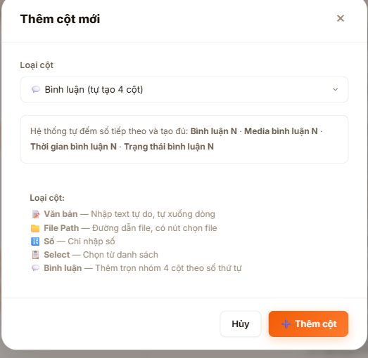

Nếu đã có Bình luận 2, lần thêm tiếp theo sẽ tự tạo Bình luận 3. Khi xóa, cả
nhóm 4 cột của bình luận đó sẽ được xóa cùng nhau.

> Bình luận tự động hiện dùng cho Facebook và Zalo Video. Facebook hỗ trợ nội
> dung chữ và media. Zalo Video chỉ hỗ trợ bình luận bằng chữ.

### 3.9. Import dữ liệu

Tool nhận file Excel hoặc CSV.

1. Vào đúng nền tảng cần nhập.
2. Bấm **Import**.
3. Chọn file.
4. Nếu file có nhiều trang dữ liệu, chọn đúng trang.
5. Xem trước 5 hàng đầu.
6. Bấm **Import**.
7. Kiểm tra dữ liệu mới trong bảng.

Nên dùng tên cột giống bảng đã Export từ tool để dữ liệu được nhận đầy đủ và
đúng thứ tự.

### 3.10. Export dữ liệu

1. Vào nền tảng cần xuất.
2. Bấm **Export**.
3. Chọn nơi lưu file.

File xuất chứa đầy đủ các cột của nền tảng hiện tại theo thứ tự trên bảng, gồm
tên profile, nội dung, media, trạng thái, link bài, thời gian đăng, bình luận và
các cột riêng đã tạo.

> Cách an toàn nhất để chuẩn bị file nhập hàng loạt là Export một file mẫu từ
> chính nền tảng cần dùng, nhập dữ liệu vào file đó rồi Import lại.

---

## 4. AI viết lại nội dung

AI có thể viết lại một hoặc nhiều hàng cùng lúc và lưu trực tiếp vào cột
**Nội dung**.

### Cách thực hiện

1. Tích một hoặc nhiều hàng.
2. Bấm nút **AI** trên đầu cột **Nội dung**.
3. Chọn dịch vụ AI đã cài đặt.
4. Nhập yêu cầu viết lại.
5. Bấm **Viết lại nội dung**.
6. Kiểm tra kết quả trong bảng.

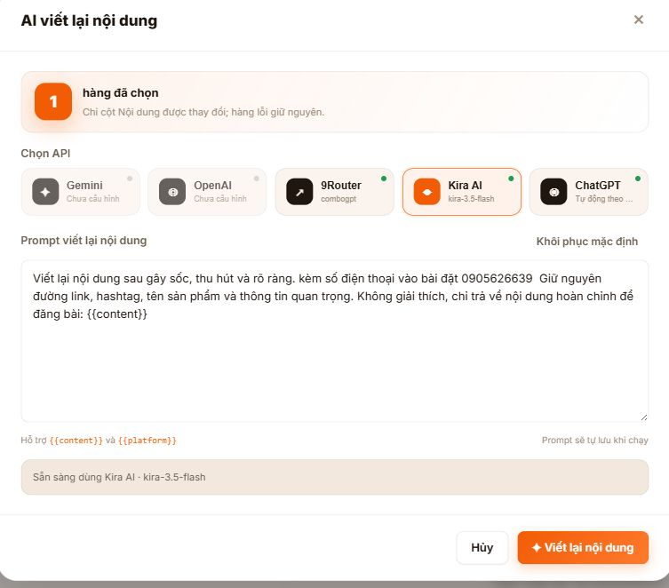

Yêu cầu viết lại được lưu để dùng cho lần sau. Nếu chưa hài lòng, có thể sửa yêu
cầu và chạy lại. Muốn trở về nội dung trước đó, bấm nút **Hoàn tác** trên thanh
công cụ.

### Gợi ý yêu cầu đơn giản

- Viết lại ngắn gọn, tự nhiên, giữ đúng ý chính.
- Viết theo phong cách bán hàng nhưng không phóng đại.
- Viết lại phù hợp với Facebook, có câu mở đầu thu hút.
- Rút gọn nội dung còn khoảng 150 từ.

> Nên chọn ít hàng để thử trước. Sau khi thấy kết quả phù hợp mới chạy số lượng
> lớn.

---

## 5. AI tạo ảnh

Ảnh tạo thành công được đưa trực tiếp vào cột **Media**.

### Cách thực hiện

1. Tích các hàng cần tạo ảnh.
2. Bấm **Ảnh AI** trên đầu cột **Media**.
3. Chọn dịch vụ tạo ảnh.
4. Nhập mô tả ảnh muốn tạo.
5. Chọn dùng ảnh hiện có làm ảnh tham chiếu nếu cần.
6. Chọn ghi đè Media nếu muốn thay ảnh đang có.
7. Bấm **Tạo ảnh và cập nhật Media**.
8. Chờ hoàn tất rồi kiểm tra cột **Media**.

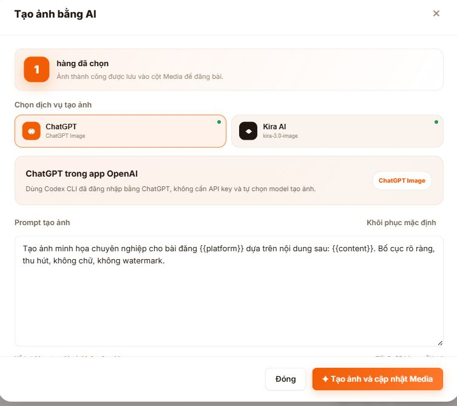

Nên chạy thử một vài hàng trước. Hàng tạo ảnh lỗi sẽ giữ nguyên Media cũ.

---

## 6. Đồng bộ dữ liệu giữa các nền tảng

Chức năng này sao chép một cột từ nền tảng đang mở sang một hoặc nhiều nền tảng
khác.

### Cách đồng bộ thủ công

1. Mở nền tảng chứa dữ liệu đúng.
2. Tại đầu cột cần đồng bộ, bấm biểu tượng đồng bộ.
3. Chọn một hoặc nhiều nền tảng đích.
4. Chọn phạm vi: hàng đã chọn, hàng đang hiển thị hoặc toàn bộ bảng.
5. Chọn **Ghi đè dữ liệu hiện có** hoặc **Chỉ điền ô trống**.
6. Bật tạo dữ liệu còn thiếu nếu cần.
7. Bấm **Xem trước đồng bộ**.
8. Kiểm tra số ô sẽ thay đổi.
9. Bấm **Đồng bộ ngay**.

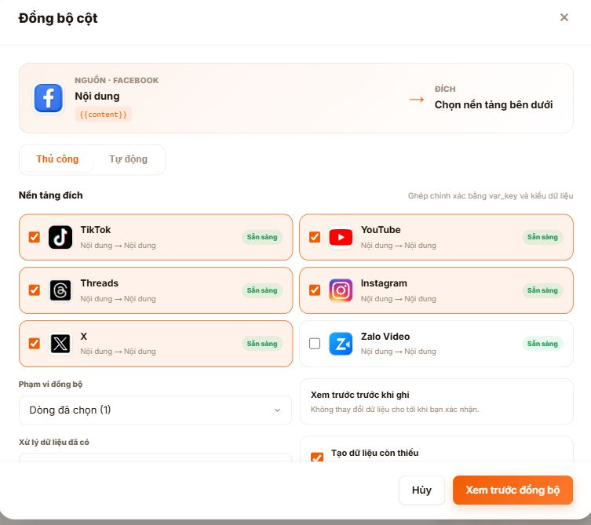

Muốn đồng bộ ngược lại, hãy mở nền tảng cần dùng làm nguồn rồi thực hiện lại.

### Đồng bộ tự động một cột

Trong cửa sổ đồng bộ:

1. Chuyển sang phần **Tự động**.
2. Chọn nền tảng đích.
3. Chọn cách xử lý dữ liệu.
4. Bật đồng bộ.
5. Bấm **Lưu**.

Sau đó, khi sửa và lưu ô ở cột nguồn, dữ liệu tương ứng sẽ được cập nhật sang
nền tảng đã chọn.

> Dùng **Chỉ điền ô trống** nếu muốn bảo vệ nội dung đã có tại nền tảng đích.

---

## 7. Đồng bộ Google Sheets

Google Sheets dùng để lưu, lấy về hoặc cập nhật dữ liệu của nhiều nền tảng.
Mỗi nền tảng nằm trong một trang riêng.

### 7.1. Kết nối lần đầu

1. Vào **Cài đặt**.
2. Tìm mục **Đồng bộ Google Sheets**.
3. Bấm **Chọn JSON** và chọn file quyền được cung cấp.
4. Sao chép email xuất hiện trên màn hình.
5. Mở Google Sheet và chia sẻ quyền chỉnh sửa cho email đó.
6. Dán link Google Sheet vào tool.
7. Bấm **Lưu**.
8. Bấm **Kiểm tra**.
9. Chỉ sử dụng khi tool báo kết nối thành công.

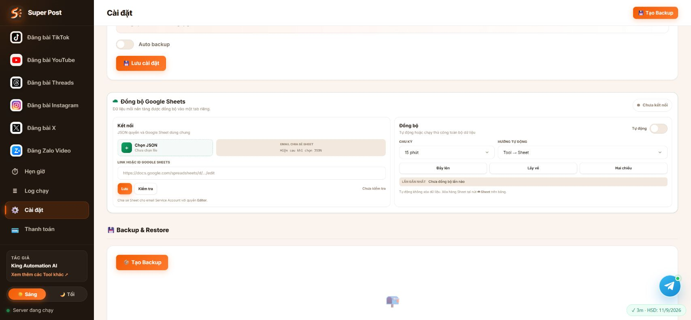

### 7.2. Đồng bộ thủ công toàn bộ dữ liệu

Tại **Cài đặt**, chọn một trong ba cách:

- **Đẩy lên**: đưa dữ liệu từ tool lên Sheet.
- **Lấy về**: lấy dữ liệu từ Sheet về tool.
- **Hai chiều**: cập nhật dữ liệu theo cả hai hướng.

### 7.3. Đồng bộ tại một nền tảng

1. Mở bảng dữ liệu của nền tảng.
2. Nếu chỉ muốn thao tác một số hàng, tích các hàng đó.
3. Bấm **Sheet**.
4. Chọn:
   - Thêm hoặc cập nhật lên Sheet.
   - Lấy dữ liệu về tool.
   - Xóa các hàng đã chọn khỏi Sheet.

Xóa khỏi Sheet không xóa dữ liệu trong tool.

### 7.4. Đồng bộ tự động

1. Vào **Cài đặt**.
2. Bật **Tự động**.
3. Chọn chu kỳ.
4. Chọn hướng đồng bộ.
5. Lưu cài đặt.

> Đồng bộ tự động không tự xóa dữ liệu. Không gửi file JSON quyền cho người
> khác.

---

## 8. Tự động hóa: chạy ngay hoặc hẹn giờ

Nút **Tự động hóa** nằm phía bên phải trên bảng dữ liệu của từng nền tảng.

### Cách chạy

1. Chuẩn bị dữ liệu và đặt các hàng cần chạy ở trạng thái **Chờ**.
2. Nếu chỉ muốn chạy một số hàng, tích các hàng đó.
3. Bấm **Tự động hóa**.
4. Tìm hoặc lọc profile theo loại và nhóm.
5. Tích một hoặc nhiều profile.
6. Chọn **Chạy ngay** hoặc **Hẹn giờ**.
7. Nếu hẹn giờ, chọn thời gian chạy.
8. Bấm **Chạy**.

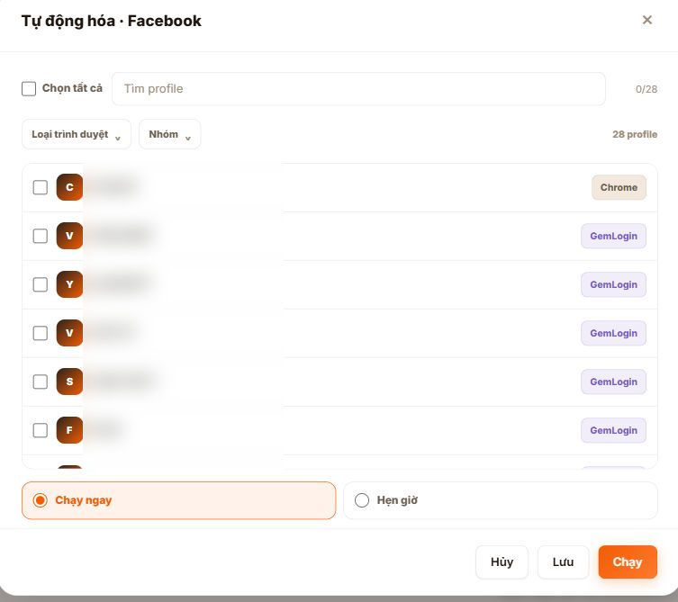

### Nguyên tắc lấy hàng

- Chỉ lấy hàng đang ở trạng thái **Chờ**.
- Tên trong cột **Tên Profile** phải khớp profile đã chọn.
- Chạy theo thứ tự hàng từ trên xuống dưới.
- Nếu đã tích một số hàng, chỉ xét các hàng đó.
- Nếu không tích hàng nào, tool xét toàn bộ bảng.
- Giới hạn mỗi lượt được lấy theo mục **Cấu hình** của nền tảng.

Nút **Lưu** giữ lại lựa chọn profile và chế độ chạy để dùng lần sau. Nút
**Chạy** đóng popup và bắt đầu tác vụ.

---

## 9. Cấu hình chung cho từng nền tảng

Tại mỗi nền tảng có hai tab: **Dữ liệu** và **Cấu hình**.

### Giới hạn mỗi lượt đăng

Nhập số bài hoặc video tối đa mà một profile chạy trong một lượt.

- `0`: không giới hạn.
- `1`: mỗi profile chỉ đăng một hàng rồi dừng.
- `2`: mỗi profile đăng tối đa hai hàng rồi dừng.

Giới hạn này áp dụng cho cả chạy ngay và hẹn giờ.

### Thao tác chống BOT trước khi đăng

1. Bấm **Cài đặt** tại phần chống BOT.
2. Bật chức năng.
3. Chọn mức an toàn.
4. Chọn số thao tác ngẫu nhiên.
5. Chọn thời gian chờ.
6. Bấm **Lưu**.

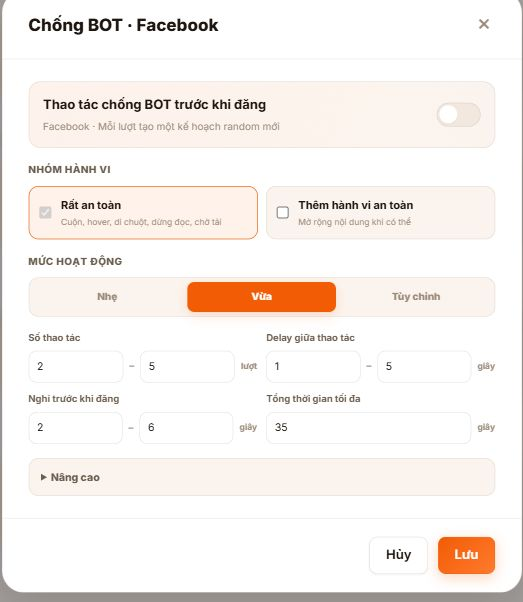

Tool sẽ thay đổi số lượt thao tác, hành vi và khoảng chờ trong phạm vi đã chọn.

### Tự động bình luận sau khi đăng

1. Bật **Tự động bình luận sau khi đăng**.
2. Đặt khoảng chờ từ lúc đăng thành công đến Bình luận 1.
3. Nếu có nhiều bình luận, đặt khoảng chờ giữa Bình luận 1 và Bình luận 2,
   Bình luận 2 và Bình luận 3...
4. Chọn có tiếp tục bình luận sau hay không khi một bình luận bị lỗi.
5. Bấm **Lưu cấu hình**.

Thời gian được chọn ngẫu nhiên trong khoảng tối thiểu và tối đa.

---

## 10. Đăng bài Facebook

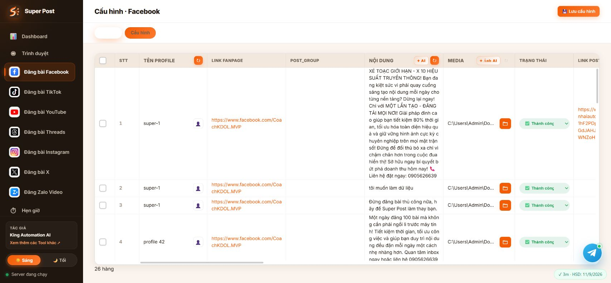

### 10.1. Đăng lên trang cá nhân

1. Chọn profile Facebook đã đăng nhập.
2. Để trống **Link Fanpage** và **Post_group**.
3. Nhập **Nội dung**.
4. Chọn **Media** nếu có.
5. Đặt trạng thái **Chờ**.
6. Bấm **Tự động hóa** và chạy.

### 10.2. Đăng lên Fanpage

1. Điền link Fanpage vào cột **Link Fanpage**.
2. Nhập nội dung và media.
3. Gán đúng profile có quyền đăng trên Fanpage.
4. Đặt trạng thái **Chờ** và chạy.

### 10.3. Đăng vào Group

Nếu chưa có cột **Post_group**:

1. Bấm **+ Cột**.
2. Chọn **Facebook Group**.
3. Bấm **Thêm cột**.

Sau đó:

1. Dán link Group vào **Post_group**.
2. Nếu đăng bằng trang cá nhân, để trống **Link Fanpage**.
3. Nếu đăng bằng Fanpage, điền thêm **Link Fanpage**.
4. Nhập nội dung, media và chạy như bình thường.

### 10.4. Thêm nhãn AI

1. Vào tab **Cấu hình** của Facebook.
2. Bật **Thêm nhãn AI**.
3. Bấm **Lưu cấu hình**.

Khi đăng media, tool sẽ bật nhãn nội dung do AI tạo. Nếu tắt lựa chọn này, luồng
đăng giữ nguyên như trước.

### 10.5. Bình luận Facebook

Facebook hỗ trợ:

- Bình luận chữ.
- Bình luận hình hoặc video.
- Bình luận vừa có chữ vừa có media.
- Nhiều bình luận liên tiếp trên một bài.
- Nội dung chứa link.

Để link trong bình luận hiển thị đúng:

1. Dán đầy đủ link vào cột Bình luận.
2. Không chèn ký tự lạ vào giữa link.
3. Để tool hoàn tất gửi bình luận; không đóng trình duyệt khi đang chạy.

Tool sẽ chờ Facebook nhận diện link rồi mới bấm gửi.

### 10.6. Kết quả

Khi thành công, tool cập nhật:

- Trạng thái **Thành công**.
- Link bài hoặc link Reel.
- Thời gian đăng.
- Thời gian và trạng thái từng bình luận.

Video Facebook thường trả về link Reel.

---

## 11. Đăng video TikTok

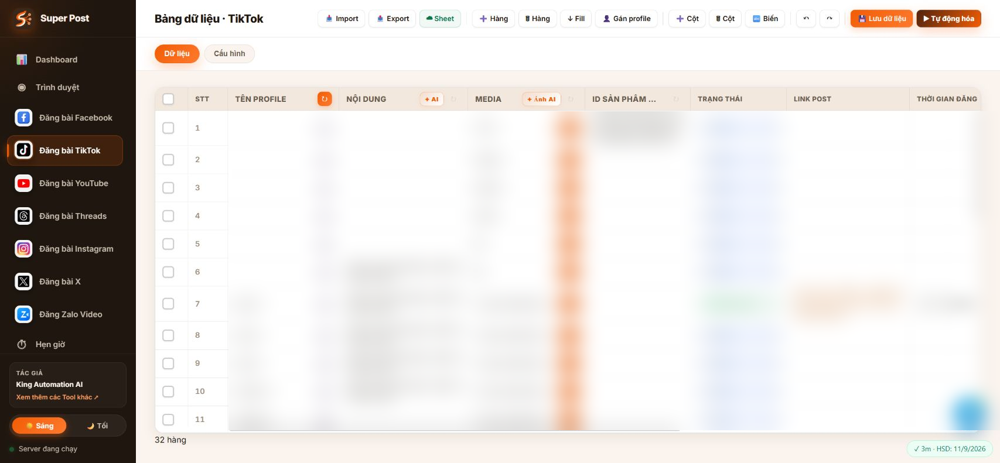

### Dữ liệu cần nhập

- **Tên Profile**: profile TikTok đã đăng nhập.
- **Nội dung**: mô tả video.
- **Media**: một video cho mỗi hàng.
- **ID Sản phẩm**: không bắt buộc.

### Cách đăng

1. Chọn đúng profile.
2. Nhập mô tả video.
3. Chọn một video trong cột Media.
4. Nếu không gắn sản phẩm, để trống ID Sản phẩm.
5. Đặt trạng thái **Chờ**.
6. Bấm **Tự động hóa** và chạy.

### Gắn một hoặc nhiều sản phẩm

- Một sản phẩm: nhập một ID.
- Nhiều sản phẩm: nhập các ID và ngăn cách bằng dấu phẩy.

Ví dụ: `1731727967401379235, 1731727967401379000`

Tool tìm từng sản phẩm theo thứ tự. Sản phẩm đúng ID và còn khả dụng sẽ được
thêm. Sản phẩm không khả dụng hoặc hết hàng sẽ được bỏ qua để tiếp tục ID kế
tiếp.

> Không có ID sản phẩm thì TikTok vẫn đăng video bình thường. Mỗi hàng TikTok
> chỉ dùng một video.

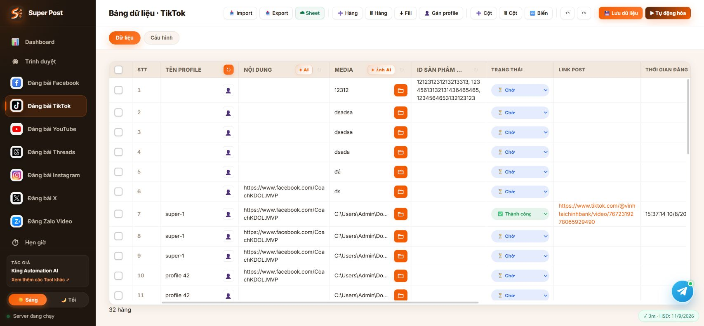

Khi TikTok báo nội dung có thể bị hạn chế hoặc không cho đăng, tool ghi trạng
thái lỗi và đưa lý do vào cột Link Post để người dùng dễ kiểm tra.

---

## 12. Đăng video YouTube

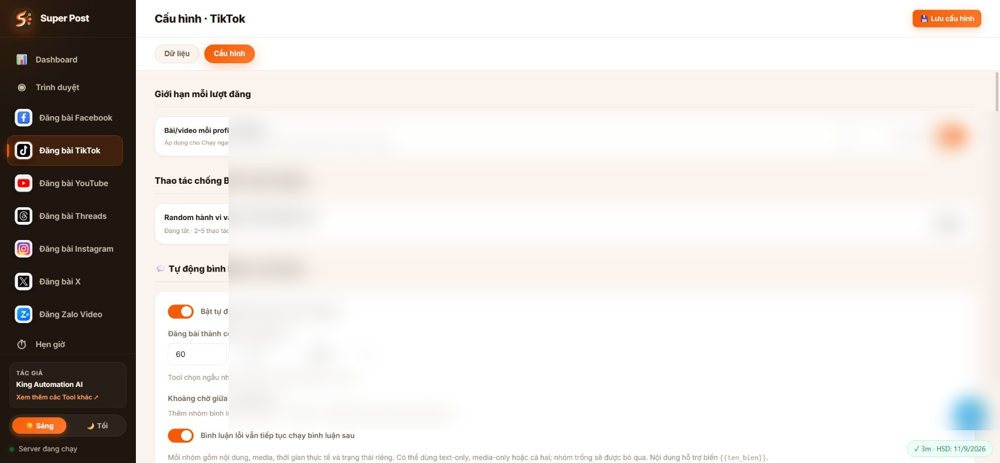

### Ý nghĩa các cột YouTube

- **Nội dung**: tiêu đề video.
- **Media**: file video.
- **Mô tả video**: phần mô tả bên dưới video.
- **Tên kênh**: dùng khi một tài khoản quản lý nhiều kênh.
- **Danh sách phát**: tên playlist cần thêm video.
- **Trạng thái lưu**: Không công khai, Riêng tư hoặc Công khai.
- **Hình Thumbnail**: ảnh bìa video.
- **Từ khóa**: từ khóa của video.

### Cách đăng

1. Điền tiêu đề tại cột **Nội dung**.
2. Chọn video tại **Media**.
3. Điền các cột còn lại nếu cần.
4. Đặt trạng thái **Chờ**.
5. Bấm **Tự động hóa** và chạy.

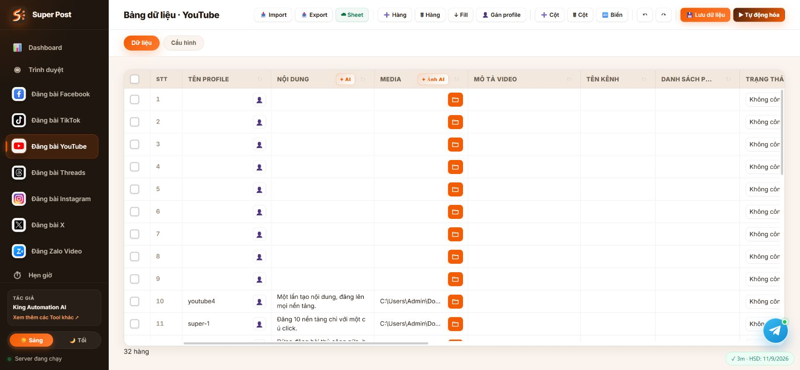

### Lưu ý

- Tiêu đề và video là bắt buộc.
- Tên danh sách phát phải giống tên đang có trên kênh.
- Nếu video dài và YouTube vẫn đang kiểm tra, tool có thể chọn **Vẫn xuất bản**.
- Nếu chưa lấy được link ngay, hàng vẫn có thể báo thành công và ghi chú link
  đang chờ cập nhật.

---

## 13. Đăng bài Threads

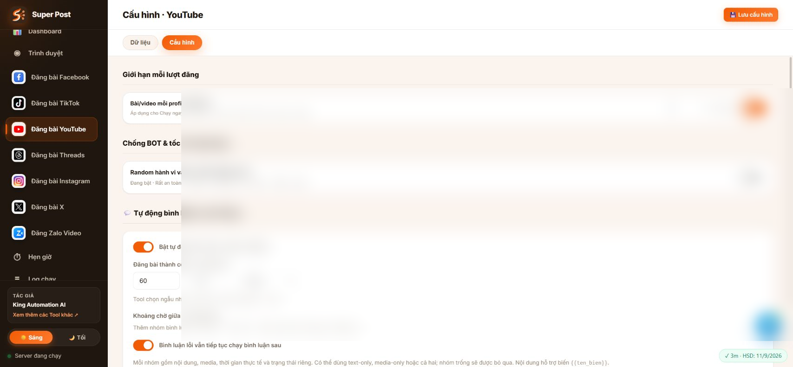

1. Chọn profile Threads đã đăng nhập.
2. Nhập nội dung, media hoặc cả hai.
3. Nếu dùng nhiều media, ngăn cách các đường dẫn bằng dấu phẩy.
4. Đặt trạng thái **Chờ**.
5. Bấm **Tự động hóa** và chạy.

Hàng Threads cần có ít nhất nội dung hoặc media.

---

## 14. Đăng bài Instagram

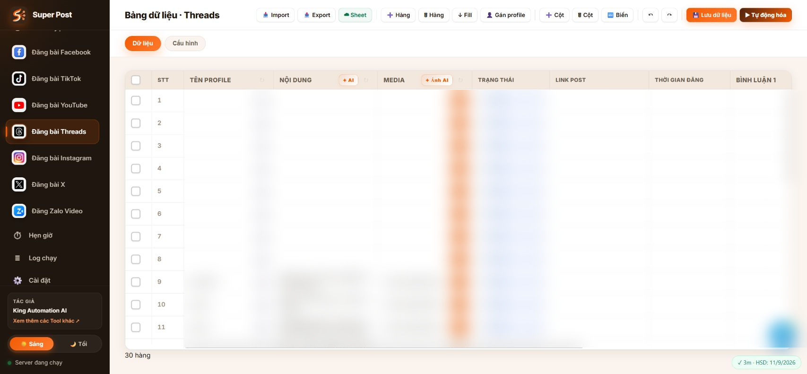

1. Chọn profile Instagram đã đăng nhập.
2. Nhập nội dung.
3. Chọn hình hoặc video tại cột **Media**.
4. Đặt trạng thái **Chờ**.
5. Bấm **Tự động hóa** và chạy.

Media là bắt buộc với Instagram. Nếu tài khoản chuyển về trang đăng nhập hoặc
xác minh, hãy mở profile và hoàn tất đăng nhập trước khi chạy lại.

---

## 15. Đăng bài X

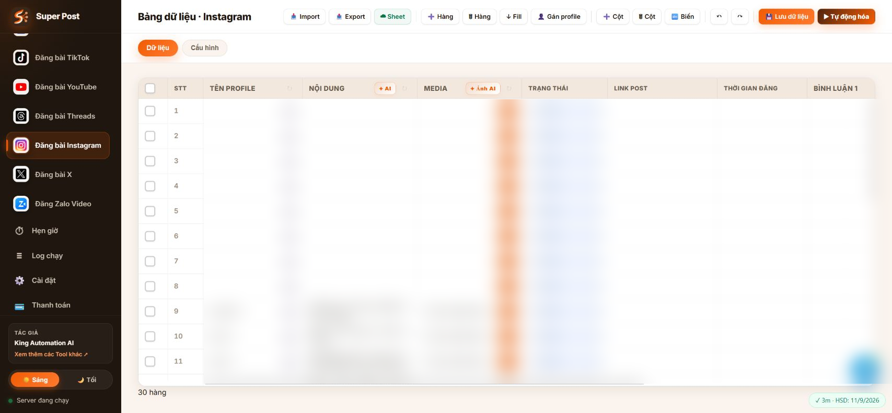

1. Chọn profile X đã đăng nhập.
2. Nhập nội dung, media hoặc cả hai.
3. Đặt trạng thái **Chờ**.
4. Bấm **Tự động hóa** và chạy.

Hàng X cần có ít nhất nội dung hoặc media. Nếu tài khoản bị giới hạn, tool sẽ
dừng hàng đó và báo lý do.

---

## 16. Đăng Zalo Video

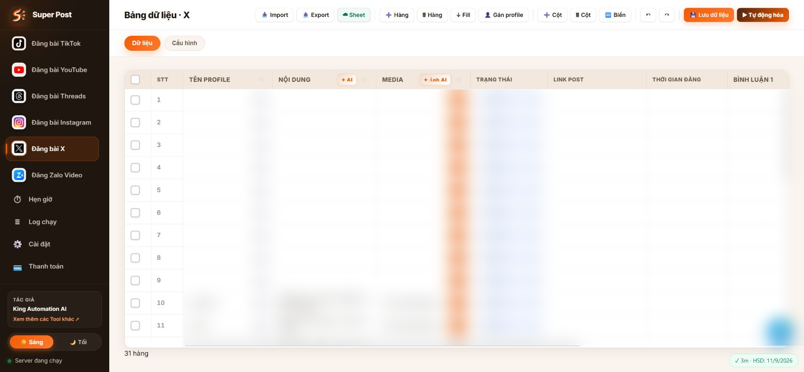

### Dữ liệu cần nhập

- **Tên Profile**: profile đã đăng nhập Zalo Video.
- **Nội dung**: nội dung video.
- **Media**: video `.mp4` hoặc `.mov`.
- **Danh sách phát**: không bắt buộc.
- **Bình luận**: nội dung chữ gửi sau khi đăng.

### Cách đăng

1. Chọn profile.
2. Nhập nội dung.
3. Chọn video.
4. Điền tên danh sách phát nếu cần.
5. Đặt trạng thái **Chờ**.
6. Bấm **Tự động hóa** và chạy.

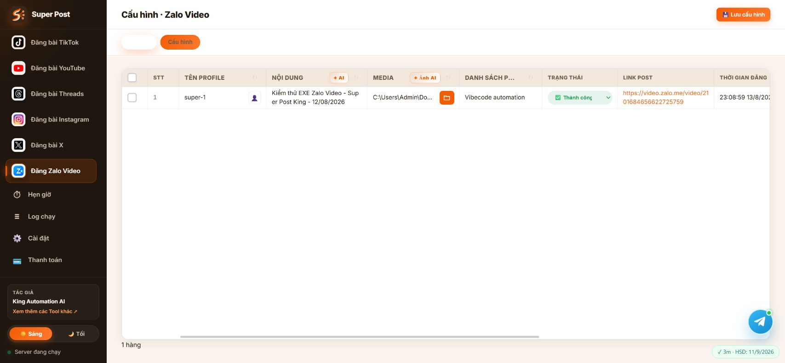

### Nhãn nội dung AI

1. Vào tab **Cấu hình**.
2. Bật **Thêm nhãn AI**.
3. Bấm **Lưu cấu hình**.

### Bình luận Zalo Video

Zalo Video hiện hỗ trợ bình luận bằng chữ. Không điền Media bình luận cho nền
tảng này.

Khi thành công, tool trả link dạng:
`https://video.zalo.me/video/...`

---

## 17. Hẹn giờ

Lịch được tạo từ nút **Tự động hóa** của từng nền tảng.

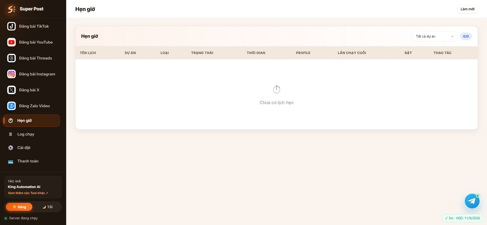

### Tạo lịch một lần

1. Mở bảng dữ liệu nền tảng.
2. Bấm **Tự động hóa**.
3. Chọn profile.
4. Chọn **Hẹn giờ**.
5. Chọn ngày và giờ.
6. Bấm **Chạy**.

### Quản lý lịch

- Lọc theo từng nền tảng.
- Xem tên lịch, thời gian, số profile và lần chạy cuối.
- Bật hoặc tắt lịch.
- Bấm **Sửa** để đổi tên, thời gian và profile.
- Bấm **Xóa** để xóa lịch.

Lịch thông thường có thể chạy một lần hoặc hàng ngày. Phần tùy chỉnh nâng cao
chỉ dùng khi đã có cấu hình cụ thể từ bộ phận hỗ trợ.

---

## 18. Log chạy

Log giúp biết tool đang làm đến đâu và vì sao một hàng bị lỗi.

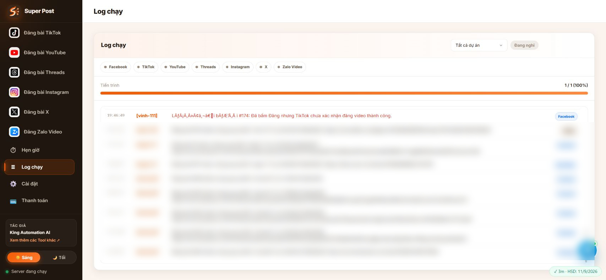

### Cách đọc log

- **Đang nghỉ**: hiện không có tác vụ chạy.
- **Đang chạy**: có ít nhất một nền tảng đang hoạt động.
- **Tiến trình**: số hàng đã xử lý trên tổng số hàng.
- Dòng màu thành công: bài đã đăng hoặc bình luận đã gửi.
- Dòng lỗi: có vấn đề cần kiểm tra.

### Thao tác

1. Chọn **Tất cả dự án** để xem tổng chung.
2. Chọn một nền tảng để lọc riêng.
3. Bấm **Dừng** nếu cần dừng tác vụ đang chạy.
4. Bấm **Xóa log** để làm gọn phần hiển thị.

Khi gặp lỗi, đọc dòng cuối cùng của đúng profile và nền tảng. Sau khi sửa dữ
liệu hoặc đăng nhập lại, đưa trạng thái hàng về **Chờ** rồi chạy lại.

---

## 19. Cài đặt AI dùng chung

Cài đặt AI dùng chung cho Facebook, TikTok, YouTube, Threads, Instagram, X và
Zalo Video.

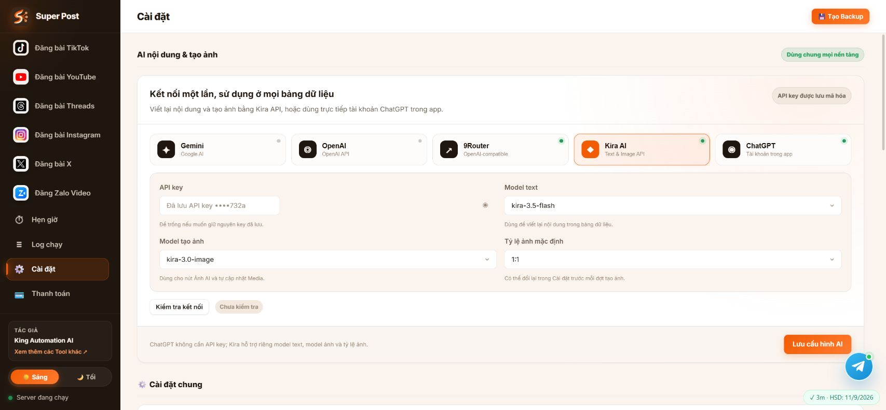

### Kết nối dịch vụ AI

1. Vào **Cài đặt**.
2. Chọn Gemini, OpenAI, 9Router, Kira AI hoặc ChatGPT.
3. Nhập khóa kết nối nếu dịch vụ yêu cầu.
4. Chọn mẫu AI muốn dùng.
5. Bấm **Kiểm tra kết nối**.
6. Khi có thông báo thành công, bấm **Lưu cấu hình AI**.

ChatGPT trong app không yêu cầu nhập khóa riêng nếu tài khoản đã được kết nối.

> Không gửi khóa kết nối AI cho người khác. Nếu chỉ muốn giữ khóa đang dùng,
> không cần nhập lại mỗi lần mở Cài đặt.

---

## 20. Cài đặt trình duyệt và tốc độ

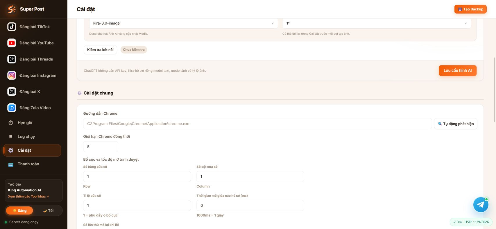

### Các lựa chọn chính

- **Đường dẫn Chrome**: bấm tự phát hiện nếu tool chưa tìm thấy Chrome.
- **Giới hạn Chrome đồng thời**: số profile Chrome được mở cùng lúc.
- **Số hàng và số cột cửa sổ**: cách sắp xếp nhiều cửa sổ trên màn hình.
- **Tỷ lệ cửa sổ**: độ lớn của từng cửa sổ.
- **Thời gian mở giữa các profile**: tăng lên nếu máy mở nhiều profile chậm.
- **Số lần thử mở lại**: dùng khi máy hoặc mạng không ổn định.
- **Delay giữa bài**: khoảng chờ ngẫu nhiên giữa hai bài.
- **Delay giữa profile**: khoảng chờ khi chuyển sang profile tiếp theo.
- **Auto backup**: tự tạo bản sao dữ liệu.

Mỗi máy và mỗi mạng có tốc độ khác nhau. Nếu tool thao tác quá nhanh hoặc hay
chờ không đủ, hãy tăng thời gian thay vì giữ một mức cố định cho mọi máy.

### Tốc độ thao tác đăng bài

1. Bấm **Cài đặt** tại phần tốc độ thao tác.
2. Chọn **Nhanh**, **Cân bằng**, **Chậm** hoặc **Tùy chỉnh**.
3. Kiểm tra khoảng chờ khi click, nhập chữ, tải media và trước khi đăng.
4. Bấm **Lưu**.

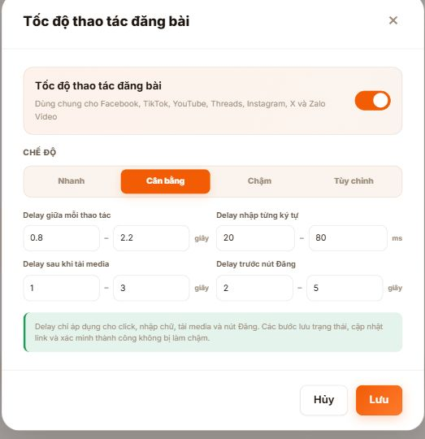

Nên bắt đầu bằng **Cân bằng**. Với máy hoặc mạng chậm, chọn **Chậm** hoặc tăng
thời gian tùy chỉnh.

---

## 21. Backup và khôi phục

Backup giúp giữ lại dữ liệu trước khi cập nhật hoặc thay đổi lớn.

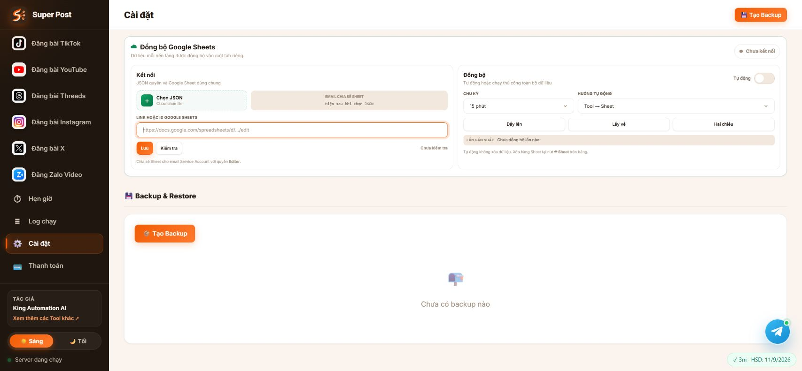

### Tạo backup

1. Vào **Cài đặt**.
2. Tìm **Backup & Restore**.
3. Bấm **Tạo Backup**.
4. Chờ thông báo thành công.

### Khôi phục

1. Chọn bản backup cần dùng.
2. Bấm **Khôi phục**.
3. Xác nhận.
4. Mở lại các bảng dữ liệu để kiểm tra.

> Khôi phục sẽ thay dữ liệu hiện tại bằng dữ liệu trong bản backup đã chọn.
> Luôn tạo backup mới trước khi khôi phục một bản cũ.

---

## 22. Thanh toán, license và cập nhật

### Kiểm tra license

Tại mục **Thanh toán**, người dùng có thể xem:

- Gói đang sử dụng.
- Trạng thái hoạt động.
- Ngày hết hạn.
- Thời gian còn lại.
- Mã máy.

Nếu cần kích hoạt, chép mã máy và làm theo hướng dẫn trên trang tài khoản. Sau
khi hoàn tất, quay lại tool và làm mới trạng thái.

### Cập nhật phiên bản

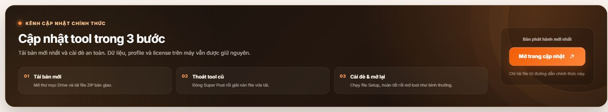

1. Tải bản mới từ đường dẫn cập nhật chính thức trong tool.
2. Đóng Super Post đang chạy.
3. Chạy file cài đặt mới.
4. Cài đè vào đúng ứng dụng Super Post.
5. Mở lại và kiểm tra dữ liệu.

Cài đè đúng bản Super Post sẽ giữ nguyên dữ liệu, profile và license trên máy.
Nên tạo backup trước khi cập nhật để an toàn hơn.

Nếu popup ghi **License đã hết hạn**, bấm **Nâng cấp / Gia hạn**, hoàn tất trên
trang tài khoản rồi quay lại bấm **Tôi đã gia hạn — Kiểm tra lại**. Chỉ khi
popup ghi cần xác thực mạng mới cần kiểm tra kết nối Internet.

---

## 23. Video hướng dẫn, tài liệu và Telegram

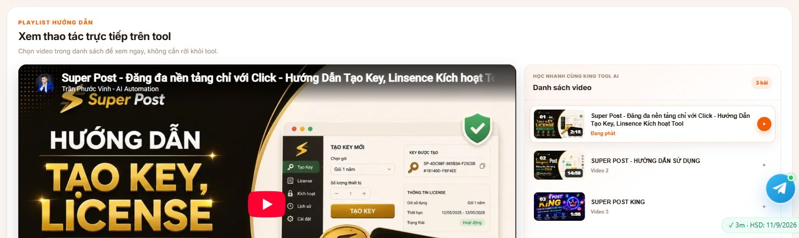

Tại mục **Cài đặt**:

- Chọn video trong playlist để xem ngay trên tool.
- Playlist tự cập nhật khi có video mới.
- Bấm mở toàn bộ playlist nếu muốn xem trên YouTube.
- Bấm tài liệu Google Docs để đọc hướng dẫn trực tuyến.

Biểu tượng Telegram nằm ở góc phải của toàn tool:

1. Bấm biểu tượng Telegram.
2. Chọn mở bằng trình duyệt hoặc ứng dụng Telegram.
3. Gửi ảnh lỗi, tên profile, nền tảng và thời điểm xảy ra lỗi để được hỗ trợ
   nhanh hơn.

### Điều khiển tool bằng Telegram

#### Kết nối lần đầu

1. Vào **Cài đặt** và mở phần **Thông báo Telegram**.
2. Dán Bot Token rồi bấm **Kết nối**.
3. Mở bot Telegram và gửi lệnh **/start**.
4. Khi bot hiện menu **Super Post - King**, có thể sử dụng ngay.

Mỗi máy khách cần kết nối bot và cài AI của mình một lần. Bộ cài đã có sẵn các
chức năng cần thiết, không phải cài thêm Node.js hoặc Python.

#### Các lệnh nhanh

Gõ dấu **/** trong ô chat để xem danh sách lệnh và mô tả. Danh sách chỉ hiện để
chọn, chưa gửi tin nhắn cho đến khi người dùng bấm một lệnh.

- **/start**: mở menu ban đầu và xóa thao tác đang làm dở.
- **/reset**: hủy lựa chọn hiện tại và quay về menu.
- **/post**: bắt đầu tạo nhiệm vụ đăng bài.
- **/status**: xem tác vụ đang chạy.
- **/report**: xem tổng kết đăng bài hôm nay.
- **/help**: mở hướng dẫn nhanh.

#### Đăng bài từ Telegram

1. Chọn **Đăng bài**, sau đó chọn **Đăng ngay** hoặc **Hẹn giờ**.
2. Chọn một hoặc nhiều nền tảng.
3. Lọc và chọn một hoặc nhiều profile.
4. Chọn cách chuẩn bị nội dung:
   - **Nhập nội dung** để tự viết.
   - **AI viết nội dung** để AI viết từ ý chính.
   - **Gửi ảnh/video** để dùng file có sẵn.
   - **AI tạo ảnh** để tạo ảnh từ mô tả.
5. Kiểm tra tin **Xác nhận nhiệm vụ đăng bài** rồi bấm đăng.

Khi chọn **Đăng ngay**, dữ liệu được đưa vào bảng theo từng profile và chuyển
sang **Đang chạy** ngay khi tool nhận nhiệm vụ. Khi chọn **Hẹn giờ**, nhiệm vụ
được lưu vào mục Hẹn giờ.

Tin xác nhận, kết quả đăng, trạng thái và tổng kết được gửi thành tin nhắn mới.
Các kết quả cũ được giữ nguyên để người dùng xem lại.

---

## 24. Chế độ sáng và tối

Ở cuối thanh menu có hai nút:

- **Sáng**: nền sáng, phù hợp sử dụng ban ngày.
- **Tối**: nền tối, phù hợp khi làm việc lâu hoặc trong môi trường thiếu sáng.

Lựa chọn được giữ lại cho lần mở tool sau.

---

## 25. Xử lý lỗi thường gặp

### Không có dữ liệu phù hợp để chạy

Kiểm tra:

1. Hàng có đang ở trạng thái **Chờ** không.
2. Tên Profile trong bảng có giống đúng tên tại mục Trình duyệt không.
3. Profile có được tích trong popup Tự động hóa không.
4. Nếu đã chọn một số hàng, hàng cần chạy có nằm trong phần đã chọn không.

### Profile chưa đăng nhập

1. Vào **Trình duyệt**.
2. Bấm **Mở** profile.
3. Đăng nhập lại nền tảng.
4. Đóng profile hoặc để tool tiếp tục sử dụng theo hướng dẫn.
5. Đưa hàng lỗi về **Chờ** và chạy lại.

### Không tìm thấy media

1. Bấm biểu tượng thư mục và chọn lại file.
2. Không đổi tên, di chuyển hoặc xóa file sau khi đã chọn.
3. Kiểm tra đúng loại file nền tảng yêu cầu.
4. Bấm **Lưu dữ liệu** rồi chạy lại.

### Tool thao tác quá nhanh

1. Vào **Cài đặt**.
2. Mở **Tốc độ thao tác đăng bài**.
3. Chọn **Chậm** hoặc tăng các khoảng chờ.
4. Với nền tảng cụ thể, mở tab **Cấu hình** và tăng mức chống BOT.

### Đăng thành công nhưng chưa có link

Một số nền tảng cập nhật link chậm, đặc biệt với video dài hoặc bài đang được
kiểm tra. Hãy:

1. Chờ thêm vài phút.
2. Làm mới bảng dữ liệu.
3. Kiểm tra bài trực tiếp trong profile.
4. Không chạy lại ngay nếu bài đã xuất hiện để tránh đăng trùng.

### TikTok không gắn được sản phẩm

- Kiểm tra đúng ID.
- Kiểm tra sản phẩm còn hàng và còn khả dụng.
- Nếu một ID lỗi, tool tiếp tục ID tiếp theo.
- Để trống ID Sản phẩm nếu chỉ cần đăng video.

### YouTube báo đang kiểm tra

Tool có thể tiếp tục xuất bản. Link có thể được cập nhật sau. Kiểm tra trạng thái
video trong YouTube Studio trước khi chạy lại.

### Zalo Video không gửi được media bình luận

Zalo Video hiện chỉ hỗ trợ bình luận chữ. Xóa Media bình luận và chạy lại.

---

## 26. Checklist trước khi bấm Chạy

- [ ] Profile đã được thêm và đăng nhập đúng tài khoản.
- [ ] Tên Profile trong bảng khớp với mục Trình duyệt.
- [ ] Nội dung đã kiểm tra.
- [ ] Media còn tồn tại và đúng định dạng.
- [ ] Hàng cần chạy đang ở trạng thái Chờ.
- [ ] Link Fanpage, Group, ID Sản phẩm hoặc playlist đã nhập đúng nếu sử dụng.
- [ ] Cấu hình nhãn AI và bình luận đúng nhu cầu.
- [ ] Đã chọn đúng profile trong Tự động hóa.
- [ ] Máy và mạng đủ ổn định.
- [ ] Đã tạo backup trước thay đổi lớn hoặc cập nhật phiên bản.

Sau khi chạy, luôn kiểm tra **Log chạy**, **Trạng thái**, **Link Post** và kết
quả thực tế trên nền tảng.
